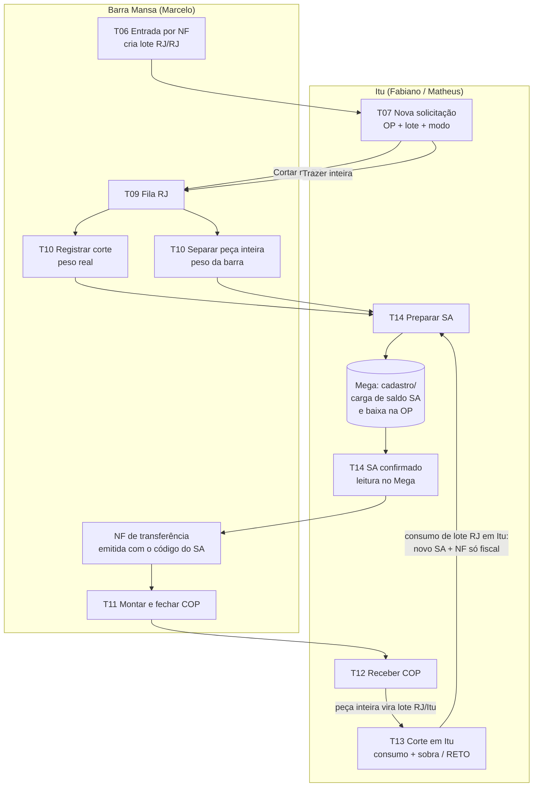
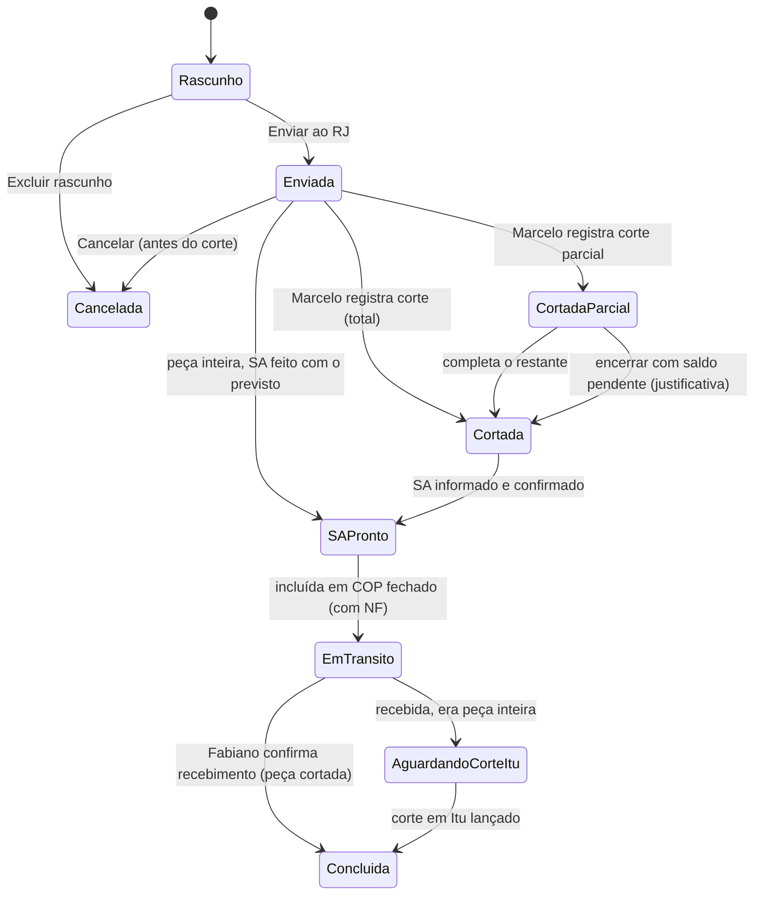

# EstoqueACK — Especificação Funcional Completa

Versão 2 para revisão, 30/10/2026. A v2 incorpora a conferência com as planilhas (`04_conferencia_planilhas_x_fluxo.md`) e as regras do Matheus. Este documento descreve o sistema **como se ele já estivesse funcionando**: o que cada tela faz, quais botões existem, de onde vem cada informação e o que acontece no banco de dados a cada ação. Ele complementa `02_proposta_arquitetura.md`, que trata da parte técnica.

Os pontos que dependem de decisão sua estão marcados como **[P01]**, **[P02]** etc. e reunidos no fim (§12).

---

## 1. Como ler este documento

### 1.1 Origem de cada informação

Cada campo das telas traz uma etiqueta que diz de onde vem o valor:

| Etiqueta | Significado |
|---|---|
| **[MEGA]** | Lido do banco Oracle do ERP Mega, somente leitura. Ex.: dados da OP, descrição do item, saldo do código Mega |
| **[LOTE]** | Herdado do lote escolhido. Ex.: contêiner, liga, bitola, planta |
| **[DIGITADO]** | O usuário digita ou escolhe |
| **[CALC]** | O sistema calcula. Ex.: peso previsto, saldo, % de sobremetal |
| **[SUGERIDO]** | O sistema preenche sozinho, mas o usuário pode alterar. Ex.: código de SA usado antes para o mesmo item |
| **[SISTEMA]** | Gerado automaticamente e não editável. Ex.: número do lote, data/hora, usuário |
| **[PLANILHA]** | Veio da carga inicial das planilhas (§10) |

### 1.2 Pessoas e perfis

| Perfil | Quem | Faz principalmente |
|---|---|---|
| Estoque Itu | Fabiano Camargo; Matheus Almeida como substituto | Solicita corte ou peça inteira, recebe COP, faz corte em Itu, lança sobra e RETO, prepara SA, faz ajustes |
| Operação RJ | Marcelo | Registra entrada por NF no RJ, executa cortes, informa peso real, monta e fecha COP |
| Análise | Renato Pinto | Consulta, relatórios, reservas e restrições, notas de compra |
| Administrador | Eduardo | Tudo, mais usuários, parâmetros, catálogo e auditoria |

### 1.3 Os três estoques

Todo lote tem uma **planta fiscal** e um **local físico**. A combinação dos dois define em qual estoque ele aparece:

| Estoque | Fiscal | Físico | Equivale na planilha a |
|---|---|---|---|
| Estoque Mega | Itu | Itu | Coluna "ESTOQUE MEGA" do Estoque Geral |
| RJ no Rio | RJ | RJ | ESTOQUE 2026 e coluna "ESTOQUE RJ (no Rio)" |
| RJ em Itu | RJ | Itu | Coluna "ESTOQUE RJ (em Itu)" |

---

## 2. Fluxo completo, do começo ao fim

O sistema tem cinco caminhos principais. Todos terminam com o material baixado na OP e rastreado até o contêiner de origem.

**Regra que vale para todo material RJ** (conferida nas planilhas, ver `04_conferencia_planilhas_x_fluxo.md` §1): o **SA + a NF de transferência** são o documento fiscal que leva o material do RJ para Itu. Por isso o SA é feito **antes do envio** do COP (corte no RJ e peça inteira) ou **no consumo em Itu** (lote RJ em Itu), e **não depois do recebimento** **[P13]**.



### 2.1 Caminho A: material RJ, cortado no RJ

Exemplo real: OP 100592, H13 33×105, CH33K.

1. **Fabiano** abre *Nova solicitação* (T07) e digita a OP. O sistema busca no Mega o item, o cliente e a medida acabada. Fabiano escolhe o lote H13 33×105 / CH33K e o modo **Cortar no RJ**. Ele informa quantidade, comprimento de corte e prazo. O sistema calcula o peso previsto e valida o sobremetal (§9). A solicitação fica **Enviada ao RJ**.
2. **Marcelo** vê a solicitação na *Fila RJ* (T09), corta e abre *Registrar corte* (T10). Ali informa peças cortadas e **peso real de balança**. Se precisou usar **outro lote ou dividir entre dois lotes**, ele informa isso ali (T10, "Usar outro lote / dividir"). O sistema valida a regra dos 5 % e **baixa o peso real do lote** (movimento `SAIDA_CORTE_RJ`). A solicitação fica **Cortada** e entra na **fila de SA** do Fabiano.
3. **Fabiano** abre *SA* (T14). O sistema já montou o pedido de SA de cada corte registrado, com material, dimensão, origem, quantidade e peso real. Se a peça acabada (item da OP) já teve SA, o sistema usa o mesmo código, seja qual for a bitola ou a MP. Só uma peça acabada que nunca teve SA exige cadastro novo (ver T14). Fabiano faz o cadastro ou a carga de saldo no Mega, como hoje, e informa o código do SA. O sistema confirma lendo o Mega. A solicitação fica **SA pronto**. Hoje isso acontece, em mediana, 1 dia antes do envio.
4. **RJ (Fio Certo / Médio Vale)** emite a **NF de transferência** com os SAs. **Marcelo** abre *COP* (T11), inclui as solicitações com SA pronto, informa a NF de cada item (um COP pode ter várias NFs) e fecha o COP nº 600. Todas as solicitações do COP ficam **Em trânsito**.
5. **Fabiano** abre *Receber COP* (T12), confere item a item e confirma. A solicitação fica **Concluída**.

### 2.2 Caminho B: material RJ, peça inteira trazida para Itu

Exemplo real: OP 100092, H13 70×610, CH25K. A peça prevista pesa 837 kg, e a barra inteira, 1.288 kg.

1. **Fabiano** cria a solicitação com o modo **Trazer peça inteira**, escolhe o lote **e a barra** (pelo comprimento do packing list, ex.: "H13 45×610×3905") **[P14]** e preenche o **sobremetal**. O sistema calcula o **peso previsto da peça** pela **bitola escolhida + sobremetal preenchido** (dimensões brutas de corte, ver T07), e não pela medida acabada. No exemplo, 837 kg. Esse peso vai para o SA e para a NF. *(Regra confirmada pelo Matheus em 2026-10-30.)*
2. **Fabiano** já prepara o **SA** (T14) com o peso previsto. Não precisa esperar o corte, porque o SA da peça inteira usa o previsto. Nas planilhas, 78 de 79 peças inteiras tiveram SA antes ou no dia do envio.
3. **Marcelo**, em T10, confirma a barra separada e o **peso da barra inteira** (1.288 kg). O peso vem [SUGERIDO] do packing list, como hoje, e pode ser corrigido pela balança. O sistema baixa 1.288 kg do lote RJ/RJ e deixa esse peso **em trânsito**. Aqui a regra dos 5 % não se aplica, porque a barra é naturalmente maior que a peça. A regra dos 5 % é aplicada no passo 6, quando a peça é pesada.
4. **Marcelo** inclui a barra no COP (T11), com a NF de transferência (que leva só o peso do SA, 837 kg), e fecha.
5. **Fabiano** recebe o COP (T12). O sistema cria automaticamente um **lote RJ em Itu** de 1.288 kg, filho do lote original (mesmo contêiner, liga e bitola). Fiscalmente, 837 kg já foram para Itu pelo SA; o resto (451 kg) continua **fiscal RJ, físico Itu**, que é exatamente o "RJ em Itu" da planilha.
6. **Fabiano** corta em Itu e lança em *Corte em Itu* (T13): consumo da OP, sobra pesada e se a sobra **ainda está na bitola** 70×610. Exemplo: consumo 837 kg e sobra 446 kg, com perda de corte de 5 kg dentro da tolerância.
   - **Peso real da peça × previsto:** se o consumo pesado passar **mais de 5 %** do peso previsto calculado no passo 1, o sistema aponta (EXCESSO_TOLERANCIA) e **pede justificativa**. Exemplo de justificativa: "Peso maior por desvio de serra, aumentou o sobremetal no comprimento".
   - **Se a sobra ainda está na bitola**, ela fica no lote RJ em Itu.
   - **Se não está**, o sistema cria um **lote RETO** (RJ em Itu), filho do lote 70×610 / CH25K.
7. O SA já foi feito no passo 2. A solicitação fica **Concluída**.

### 2.2b Caminho B2: corte em Itu de material RJ em Itu (sobras e RETO que já estão em Itu)

Nas planilhas, é **45 % de todos os SAs** desde maio/2025 (649 de 1.438), e esse caminho não passa pelo Controle de Corte. Exemplo: em 2025-05-08, dezenas de OPs com H13 28×610 / CH31K, de 7 a 300 kg cada, NFs 556–558.

1. **Fabiano** lança em *Corte em Itu* (T13): OP, lote RJ em Itu (ou RETO RJ em Itu), consumo, sobra e se a sobra mantém a bitola.
2. Como o lote é **fiscal RJ**, o sistema cria automaticamente a linha na **fila de SA** (T14), com o consumo pesado, o material, a bitola (ou "RETO") e o contêiner de origem.
3. **Fabiano** faz o SA no Mega e informa o código. O **RJ emite a NF de transferência só fiscal** (o material não viaja), e o Fabiano informa o nº da NF no SA (várias linhas de SA podem usar a mesma NF).
4. A baixa na OP é feita no Mega com o código do SA, como hoje.

### 2.3 Caminho C: material Mega (fiscal e físico em Itu)

1. **Entrada:** a NF é lançada no Mega, como hoje. Na sincronização, o sistema detecta saldo novo no código Mega e cria uma pendência em *Entradas Mega a classificar* (T15). Fabiano informa o contêiner e confirma, e o sistema cria o lote ITU/ITU **[P01]**.
2. **Uso:** Fabiano lança em *Corte em Itu* (T13): OP, lote, consumo e sobra, dentro ou fora da bitola. O sistema baixa o lote e, se for o caso, cria o lote RETO com a origem.
3. **ERP:** a baixa na OP e a transferência de saldo do código original para o código RETO continuam sendo feitas **no Mega**. O sistema mostra a instrução pronta, por exemplo: "Baixar 104,5 kg do código 78290 na OP 100508. Transferir 12,0 kg do código 78290 para o código 1698 (H13 RETO)". Depois, a *Conciliação* (T16) confere se o Mega bate.

### 2.4 Caminho D: entrada de material novo no RJ

**Marcelo** lança a NF de entrada em T06, com contêiner, itens, bitolas, peças e peso de cada item. Cada linha vira um **lote RJ/RJ** com saldo inicial igual ao peso informado.

---

## 3. Situações (estados) de cada documento

### 3.1 Solicitação de corte



| Situação | Quem altera | Efeito no estoque |
|---|---|---|
| Rascunho | Estoque Itu | Nenhum |
| Enviada | Estoque Itu | **Reserva** o peso previsto no lote: ele aparece como "reservado" e não está mais disponível para outras solicitações |
| Cortada / parcial | Operação RJ | Baixa o **peso real** do lote (ou dos lotes, se dividiu) e libera a reserva. Entra na fila de SA |
| SA pronto | Estoque Itu, ao informar o código do SA (confirmado no Mega) | Nenhuma. Libera o item para entrar no COP |
| Em trânsito | Operação RJ, ao fechar o COP com a NF | Nenhuma mudança de saldo. O material fica "em trânsito" |
| Aguardando corte em Itu | Estoque Itu, ao receber peça inteira | Cria o lote RJ em Itu com o peso da barra |
| Concluída | Estoque Itu, ao receber (peça cortada) ou ao lançar o corte em Itu (peça inteira) | Fecha a rastreabilidade OP ↔ lote ↔ SA ↔ NF ↔ COP |
| Cancelada | Estoque Itu (antes do corte) | Libera a reserva. Depois do corte, é preciso usar o estorno (§8) |

### 3.2 COP

`Aberto` (Marcelo incluindo itens com SA pronto) → `Fechado / em trânsito` (Marcelo fecha; cada item tem a sua NF de transferência, e um COP pode ter várias NFs) → `Recebido parcial` → `Recebido` (Fabiano). Um COP fechado não aceita mais itens. Para corrigir, Marcelo usa *Reabrir COP*, que exige justificativa e só vale enquanto nada tiver sido recebido.

### 3.3 SA

Nasce em três momentos: corte registrado no RJ (T10), solicitação de peça inteira enviada (T07) ou corte em Itu de lote fiscal RJ (T13).

`Pendente de preparo` → `Preparado` (dados conferidos e pedido exportado) → `Aguardando confirmação no Mega` (código informado) → `Confirmado` (o sistema achou o código e a carga no Mega). Se a confirmação não vier em 48 horas (configurável), o SA aparece em vermelho no painel.

### 3.4 Lote

`Ativo` → `Esgotado` (saldo zero, sai das listas padrão mas continua consultável). Um lote nunca é apagado.

**Peças do lote [P14]:** o lote guarda as suas **peças** (barra ou chapa inteira, ou pedaço), cada uma com comprimento e peso. A carga vem do packing list (aba HISTORICO), que já registra muitos contêineres barra a barra (ex.: "H13 75×610×3830 – 1.418 kg"). É isso que permite escolher a barra na peça inteira e saber quantas inteiras e quantos pedaços restam ("6 PEÇAS / 1 PEDAÇO", como nos comentários da ESTOQUE 2026). Para barras finas com dezenas de unidades, basta a contagem.

---

## 4. Navegação

```
Menu lateral (aparece conforme o perfil)
├── Painel                                (todos)
├── Estoque
│   ├── Consulta de estoque               (todos)
│   └── Detalhe do lote                   (todos, abre a partir da consulta)
├── Barra Mansa
│   ├── Entrada por NF                    (Operação RJ)
│   ├── Fila RJ / Registrar corte         (Operação RJ; Estoque Itu só consulta)
│   └── COP                               (Operação RJ; Estoque Itu consulta e recebe)
├── Itu
│   ├── Solicitações de corte             (Estoque Itu)
│   ├── Receber COP                       (Estoque Itu)
│   ├── Corte em Itu (consumo/sobra/RETO) (Estoque Itu)
│   ├── SA                                (Estoque Itu)
│   └── Entradas Mega a classificar       (Estoque Itu)
├── Controle
│   ├── Conciliação com o Mega            (Estoque Itu, Análise)
│   ├── Reservas e restrições             (Estoque Itu, Análise)
│   ├── Ajuste de inventário / estorno    (Estoque Itu, com justificativa)
│   └── Relatórios                        (todos)
├── Calculadora de peso                   (todos)
└── Administração                         (Admin)
    ├── Usuários
    ├── Catálogo: ligas, densidades, itens de MP
    ├── Parâmetros (tolerâncias, prazos)
    ├── Auditoria
    └── Carga inicial das planilhas
```

Em todas as telas há uma busca global no topo. Ela aceita um número de OP, de lote (L-000123), de COP, de SA ou de contêiner (CH11EA) e abre direto o item encontrado.

---

## 5. Telas, uma a uma

Padrão de todas as telas: cada botão tem um nome que diz o que faz. As validações aparecem **antes** de gravar, em três cores:

- **vermelho:** bloqueia;
- **amarelo:** exige "estou ciente" e justificativa;
- **cinza:** é só um aviso.

Toda gravação gera um registro na auditoria com usuário, data/hora e IP.

### T01. Entrar

| Campo | Origem |
|---|---|
| Login | [DIGITADO] |
| Senha | [DIGITADO] |

**Botão "Entrar":** se der certo, abre o Painel. Se a senha for temporária, abre T02. Depois de 5 erros seguidos, a conta fica bloqueada por 15 minutos.

### T02. Trocar senha

Campos: senha atual, nova senha e repetição da nova [DIGITADO]. **Botão "Salvar nova senha".** A senha precisa ter pelo menos 10 caracteres, com letras e números, e não pode conter o login.

### T03. Painel

O que aparece depende do perfil.

- **Barra de estoque:** total em kg e divisão entre Estoque Mega, RJ no Rio e RJ em Itu [CALC, a partir dos saldos dos lotes].
- **Minhas pendências:** lista clicável.
  - *Estoque Itu:* **SAs pendentes que estão segurando COP no RJ** (no topo), COPs em trânsito para receber, peças inteiras aguardando corte em Itu, SAs sem confirmação, entradas Mega a classificar.
  - *Operação RJ:* fila de corte por prazo, cortes aguardando SA de Itu, cortes com SA pronto fora de COP, COP aberto.
  - *Análise:* lotes com reserva vencendo, divergências com o Mega, exceções de tolerância da semana.
- **Atrasos:** solicitações com a mesma regra da planilha atual: até 7 dias Normal, até 15 dias Atenção, acima disso Atrasado [CALC, data de envio × hoje].
- **Divergências com o Mega:** quantidade de códigos cuja soma dos lotes ITU/ITU difere do saldo do Mega acima de X kg [CALC + MEGA].
- **Última sincronização com o Mega:** data/hora e situação [SISTEMA].

### T04. Consulta de estoque

Filtros (todos [DIGITADO]):

- estoque (Mega / RJ no Rio / RJ em Itu / todos);
- liga;
- bitola (espessura, largura ou diâmetro, com faixa "de/até");
- formato (retangular / redondo / RETO);
- contêiner;
- código Mega;
- "somente com saldo";
- "somente com reserva ou restrição";
- "somente origem não identificada".

**Modos de visão:** *por lote* (uma linha por lote) e *agrupado por item* (soma por liga + bitola, parecida com o Estoque Geral de hoje).

| Coluna | Origem |
|---|---|
| Lote | [SISTEMA] |
| Contêiner | [LOTE] |
| Liga / bitola / descrição | [LOTE] → catálogo |
| Código Mega | [LOTE] → catálogo [MEGA] |
| Estoque | [CALC] fiscal × físico |
| Saldo kg | [CALC] soma dos movimentos |
| Reservado kg | [CALC] solicitações enviadas + reservas |
| Disponível kg | [CALC] saldo − reservado |
| Origem | [CALC] contêiner/bitola raiz, para lotes SOBRA e RETO |
| Indicadores | Ícone de reserva/restrição, nota do Renato, origem não identificada |

Botões:

- **"Exportar para Excel":** gera a lista filtrada.
- **"Nova solicitação com este lote":** só para Estoque Itu; abre T07 com o lote preenchido.
- Clicar numa linha abre T05.

### T05. Detalhe do lote

Seções da tela:

1. **Cabeçalho:** lote, contêiner, liga, bitola, estoque, saldo, reservado, disponível, peso e peças iniciais, NF de entrada, data de entrada.
1b. **Peças:** lista de barras/chapas e pedaços com comprimento, peso e situação (disponível / reservada / consumida) **[P14]**.
2. **Árvore de origem:** do lote original até os filhos (sobras e RETO), cada um com seu saldo.
3. **Movimentos:** data, tipo, kg (+/−), OP, COP, SA, usuário e justificativa, em ordem cronológica, com saldo acumulado.
4. **Reservas e restrições** vigentes.
5. **Notas:** comentários do Renato e de outros usuários.

Botões:

- **"Adicionar nota"**: todos.
- **"Adicionar reserva ou restrição"**: Estoque Itu e Análise; abre T17.
- **"Ajustar saldo"**: Estoque Itu; abre T18.
- **"Imprimir ficha do lote"**: PDF com o resumo.

### T06. Entrada por NF (Barra Mansa)

Quem usa: Marcelo. Objetivo: registrar o material que chega ao RJ e criar os lotes RJ/RJ.

| Campo | Origem | Regra |
|---|---|---|
| Nº da NF, data, fornecedor | [DIGITADO] | Bloqueia se a NF + fornecedor já tiver sido lançada |
| Contêiner | [DIGITADO], com lista dos já existentes | Se não existir, cria; se existir, adiciona itens ao contêiner |
| Itens (várias linhas) | — | — |
| ↳ Liga | [DIGITADO] lista do catálogo | — |
| ↳ Formato e bitola | [DIGITADO] | — |
| ↳ Descrição como na NF | [DIGITADO] | O sistema interpreta e sugere liga/bitola [SUGERIDO] |
| ↳ Quantidade de barras/chapas | [DIGITADO] | — |
| ↳ Peso (kg) | [DIGITADO] | Peso da NF/balança |
| ↳ Comprimento | [DIGITADO], opcional | Ex.: "2800–6000" |
| ↳ Valor R$/kg | [DIGITADO], opcional | Fora do foco inicial |
| ↳ Peso teórico | [CALC] | Aviso cinza se diferir do peso informado em mais de 20 % (possível erro de digitação) |

Botões:

- **"Adicionar item".**
- **"Salvar entrada":** cria um lote por linha (movimento `ENTRADA`).
- **"Cancelar".**

Depois de salvar, a entrada só pode ser corrigida por estorno (T18).

### T07. Nova solicitação de corte

Quem usa: Fabiano e Matheus. É um assistente em quatro passos.

**Passo 1, OP:**

| Campo | Origem |
|---|---|
| Nº da OP | [DIGITADO] |
| Item (código e descrição) | [MEGA] pela OP |
| Cliente | [MEGA] pela OP |
| Situação da OP | [MEGA]. Bloqueia se estiver encerrada ou cancelada |
| Quantidade da OP | [MEGA] |
| MP prevista na estrutura | [MEGA], só informativo. Você informou que geralmente não é a correta |
| Medida acabada (E × L × C ou Ø × C) | [SUGERIDO] da descrição do item no Mega, editável |
| Comprimento fixado / múltiplo do item | [LOTE] → catálogo (vem da coluna "COMPR. FIXADOS" do Estoque Geral, ex.: "MULT. 1820", "3110MM (MIN)"). Só informativo |
| Histórico desta OP | [CALC] solicitações e SAs já existentes. Amarelo se já houver |

**Passo 2, lote:** o sistema lista os **lotes compatíveis**: mesma liga, bitola capaz de comportar a medida acabada e saldo disponível. A ordem é: menor sobremetal primeiro, depois o lote mais antigo. Para cada lote aparecem estoque, saldo disponível, % de sobremetal estimado e um ícone de reserva ou restrição. O usuário escolhe um lote. Para usar mais de um lote na mesma OP, ele adiciona um segundo, como no caso da OP 100553 (21×202 do CH11EA e 21×203 do CH40SH). No modo **peça inteira**, depois do lote o usuário escolhe **a barra** (comprimento e peso do packing list) **[P14]**. Lotes de **liga equivalente** (ex.: 1.2344 para H13) aparecem com o selo "liga equivalente" e pedem "estou ciente" **[P18]**. Item de MP marcado como **"substituído por"** no catálogo mostra o aviso e sugere o substituto.

**Passo 3, corte:**

| Campo | Origem | Regra |
|---|---|---|
| Modo | [DIGITADO]: Cortar no RJ / Trazer peça inteira / Cortar em Itu (lote em Itu) | O modo depende do local físico do lote |
| Quantidade de peças | [SUGERIDO] da quantidade da OP | — |
| Sobremetal no comprimento (mm) | [SUGERIDO] 5 mm, editável | Padrão confirmado nas planilhas: 5 mm em 280 de 394 instruções |
| Sobremetal na largura (mm) | [SUGERIDO] 5 mm quando a peça sai de chapa larga; 0 quando usa a largura inteira da barra | Editável |
| **Dimensões brutas de corte (E × L × C ou Ø × C)** | [CALC] **espessura (ou Ø) = da bitola**; **largura = da bitola** se a peça usa a largura inteira, senão largura acabada + sobremetal; **comprimento = acabado + sobremetal**. Cada uma editável | É o "bitola escolhida + sobremetal preenchido" do Matheus. Ex.: OP 91050, peça 23×65×165,2 de bitola 28×610 → bruto ≈ 28 × 70 × 170 |
| Comprimento de corte por peça (mm) | [CALC] = comprimento bruto | — |
| Instrução para o RJ | [SUGERIDO] "12 PEÇAS COM 255MM COMPRIMENTO" ou "TRAZER 01 PEÇA H13 70X610" | Mesmo texto usado hoje |
| Peso da peça acabada | [CALC] medida acabada × densidade da liga | Só referência para o sobremetal % |
| Peso previsto | [CALC] **dimensões brutas de corte** × quantidade × densidade | Base da regra dos 5 % na pesagem (T10 no corte RJ; T13 na peça inteira e no corte em Itu). Na **peça inteira**, é o peso que vai para a NF e o SA |
| Sobremetal % | [CALC] (previsto − peça acabada) / peça acabada | Acima de 20 %: amarelo, justificativa obrigatória |
| Prazo | [SUGERIDO] da data de entrega da OP [MEGA], editável | — |
| Instrução de processo | [DIGITADO], com opções rápidas "Retificar espessura", "Retificar largura", "Peça bipartida", "Usar sobras" | Aparece na Fila RJ e na lista de corte impressa (hoje são notas do almoxarifado nas células) |
| Observação | [DIGITADO] | — |

**Passo 4, revisão:** resumo, painel de validações e campos de justificativa para cada item amarelo.

Botões:

- **"Salvar rascunho".**
- **"Enviar ao RJ":** a solicitação fica *Enviada* e reserva o peso no lote (no modo peça inteira, reserva a barra escolhida). Marcelo é notificado. No modo peça inteira, a linha já entra na fila de SA com o peso previsto.
- Para lotes já em Itu, **"Registrar corte em Itu agora"** vai direto para T13.

### T08. Solicitações de corte (lista)

Filtros: situação, OP, cliente, liga, contêiner, período, "somente atrasadas".

Colunas: data, OP, item, cliente, MP/bitola, contêiner, modo, quantidade, peso previsto, peso real, prazo, situação com a cor do atraso, COP.

Botões:

- **"Nova solicitação".**
- **"Exportar".**
- Na linha: **"Abrir"**, **"Cancelar"** (só antes do corte) e **"Duplicar"** (cria outra solicitação parecida, útil para OPs do mesmo item).

### T09. Fila RJ

Quem usa: Marcelo. É a lista das solicitações *Enviadas* e *Parciais*, ordenada por prazo, com a cor de atraso. Ela funciona bem no tablet ou no celular.

Colunas: OP, item, cliente, MP, contêiner, instrução de corte, quantidade, prazo, dias em aberto.

Botões:

- **"Registrar corte"**: abre T10.
- **"Material insuficiente"**: marca a solicitação, notifica o Fabiano e exige observação (caso "MAT. INSUFICIENTE" da planilha).
- **"Imprimir lista de corte do dia"**: PDF para levar à máquina.

### T10. Registrar corte (RJ)

| Campo | Origem | Regra |
|---|---|---|
| Dados da solicitação | [SISTEMA] da solicitação | Só leitura |
| Lote usado | [LOTE] da solicitação; pode ser trocado ou dividido pelo botão abaixo | Nas planilhas, 14 % dos consumos saíram de contêiner diferente do pedido |
| Barra separada (peça inteira) | [SUGERIDO] a barra reservada; pode trocar por outra do mesmo lote | — |
| Peças cortadas | [DIGITADO] | Aviso se for maior que o solicitado; menor deixa a solicitação parcial |
| Peso real (kg) | [DIGITADO], balança. Peça inteira: [SUGERIDO] peso da barra no packing list, editável | Corte: acima de 5 % do bruto previsto, justificativa obrigatória; abaixo de 20 %, aviso. Peça inteira: bloqueia se for maior que o saldo do lote |
| Data do corte | [SISTEMA] hoje, editável para até 7 dias atrás | — |
| Observação | [DIGITADO] | — |

Botões:

- **"Usar outro lote / dividir"**: adiciona linhas com outro lote (mesma liga, bitola que comporte a peça), cada uma com peças e peso. Exige justificativa e notifica o Fabiano. Cada lote gera a sua linha de SA, como já acontece na planilha (ex.: "CH40SH - 16 PEÇAS 630,5KG / CH11EA - 4 PEÇAS 156,5KG").
- **"Confirmar corte"**: movimento `SAIDA_CORTE_RJ` em cada lote usado, com o peso real negativo e a reserva liberada. A solicitação entra na fila de SA.
- **"Voltar".**

### T11. COP

**Lista de COPs:** número, data, situação, quantidade de itens, peso total e NF.

**Tela do COP aberto:**

| Campo | Origem |
|---|---|
| Nº do COP | [SUGERIDO] próximo número da sequência (último importado foi 600), editável |
| Itens | [DIGITADO] marcando os cortes com **SA pronto** que ainda não estão em COP. Cortes sem SA aparecem cinza, com "SA pendente" |
| Peso total | [CALC] |
| NF de transferência | [DIGITADO] **uma vez no COP**, com o emitente (Fio Certo / Médio Vale), e copiada para todos os itens. Esse é o caso comum: 27 de 38 COPs de 2026 tiveram uma única NF. Exceção: botão "NF diferente para itens selecionados"; uma mesma NF também pode ser usada em dois COPs seguidos (3 casos em 2026). Fica gravada em cada linha de SA. Equivale à coluna "NF FIOCERTO/MEDIO VALE" da planilha de SA |
| Data de envio | [SISTEMA] ao fechar |

Botões:

- **"Novo COP".**
- **"Adicionar cortes prontos".**
- **"Remover item".**
- **"Fechar COP e enviar":** só fica ativo quando todos os itens têm SA pronto e NF. Os itens ficam *Em trânsito* e Fabiano é notificado.
- **"Imprimir romaneio":** PDF com OP, item, MP, contêiner, peças e peso.
- **"Reabrir COP":** só se nada tiver sido recebido; exige justificativa.

### T12. Receber COP

Quem usa: Fabiano e Matheus. A tela mostra os COPs *Em trânsito*. Ao abrir um, aparece a lista de itens com uma caixa de conferência por linha.

| Campo por item | Origem | Regra |
|---|---|---|
| OP, MP, contêiner, peças, peso enviado | [SISTEMA] do COP | — |
| Recebido | [DIGITADO] caixa de seleção | — |
| Peso conferido em Itu (kg) | [DIGITADO], opcional | Se diferir do enviado em mais de 2 %, amarelo com justificativa. É registrado como divergência de transporte |

Botões:

- **"Confirmar recebimento"** (dos itens marcados).
- **"Registrar divergência"** (item faltando ou danificado; notifica o Marcelo).

Efeitos:

- **Peça cortada:** fica *Concluída* (o SA já foi feito antes do envio).
- **Peça inteira:** o sistema cria o **lote RJ em Itu**, filho do lote de origem, com o peso recebido (movimento `RECEBIMENTO_ITU`). A solicitação fica *Aguardando corte em Itu*.

### T13. Corte em Itu (consumo, sobra e RETO)

Quem usa: Fabiano e Matheus. Vale para lotes **RJ em Itu** (peças inteiras e sobras) e **Estoque Mega**.

| Campo | Origem | Regra |
|---|---|---|
| OP | [DIGITADO] → item e cliente [MEGA] | Mesmas validações de T07 |
| Lote | [DIGITADO] ou [SUGERIDO] (peça inteira recebida para a OP) | — |
| Peso do lote antes | [CALC] saldo atual | — |
| Peças produzidas | [DIGITADO] | — |
| Consumo da OP (kg) | [DIGITADO], balança | Regra dos 5 % sobre o peso previsto da solicitação (bitola + sobremetal). Acima → justificativa (ex.: desvio de serra) |
| Sobra (kg) | [DIGITADO], balança | 0 se não houver |
| A sobra mantém a bitola original? | [DIGITADO] Sim / Não | Não → cria lote RETO |
| Perda de corte | [CALC] antes − consumo − sobra | Amarelo se passar da perda esperada (§9) |
| Reservas/restrições do lote | [LOTE] | Amarelo, exige "estou ciente" |

O sistema mostra o resultado antes de gravar. Exemplo: "Lote L-000451 passa de 1.288,0 kg para 0 kg. Novo lote RETO L-000452 com 446,0 kg, origem H13 70×610 / CH25K."

Botões:

- **"Confirmar"**: grava os movimentos `CONSUMO_OP`, `GERA_RETO` e `GERA_SOBRA`.
- **"Cancelar".**

Para lote **fiscal RJ** (RJ em Itu, inclusive RETO), ao confirmar, o sistema cria a linha na **fila de SA** com o consumo, a bitola (ou "RETO") e o contêiner de origem (Caminho B2, §2.2b). Se o lote veio de uma peça inteira cujo SA já foi feito com o previsto, o sistema liga o consumo a esse SA em vez de criar outro.

Para lote Mega, depois de confirmar, aparece um quadro **"Fazer no Mega"** com a baixa na OP e a transferência para RETO já descritas, e o botão **"Copiar instrução"**.

### T14. SA

**Fila:** uma linha por OP + lote, com situação (Pendente / Preparado / Aguardando Mega / Confirmado). As linhas nascem de três lugares: **corte registrado no RJ** (T10), **solicitação de peça inteira enviada** (T07) e **corte em Itu de lote fiscal RJ** (T13). A fila mostra no topo os itens que estão **segurando um COP** no RJ.

**Pedido de SA**, com os mesmos campos da planilha atual:

| Campo | Origem |
|---|---|
| Data | [SISTEMA] |
| OP | [SISTEMA] da solicitação |
| Cliente | [MEGA] pela OP |
| Código do item | [MEGA] pela OP |
| Material | [LOTE] liga |
| Dimensão | [LOTE] bitola, ou "RETO" se o lote for RETO |
| Origem (contêiner) | [LOTE] |
| Quantidade | [SISTEMA] peças cortadas/produzidas |
| Peso | [CALC] peso previsto (bitola + sobremetal) para peça inteira, ou peso real do corte para corte no RJ [P03] |
| Valor precificador | [CALC] R$/kg × peso ÷ quantidade. O R$/kg usado hoje **não é** o "valor unitário" da ESTOQUE 2026 (ex.: CH11EA A8 21×202: 13,11 lá, 14,06 no SA); a origem será definida **[P16]** |
| Código Mega do SA | [SISTEMA] o código de SA **mais recente e ativo** já usado para o **item da peça acabada** (o item da OP). Ver regra abaixo |
| Descrição | [SUGERIDO] "SA <descrição do item [MEGA]> - CÓD.<item>" ou a do SA anterior |
| NCM, ICMS, IPI | [SUGERIDO] do SA anterior do mesmo item, ou [MEGA] do cadastro do item |

**Regra do código de SA** *(confirmada pelo Matheus em 2026-10-30)*: o código de SA pertence ao **item da peça acabada**, que é o item que vem na OP. A bitola, a liga e a matéria-prima **não importam**.

- **A peça acabada já teve SA:** o código é o mesmo, preenchido pelo sistema, mesmo que a bitola ou a MP agora sejam outras. Não há cadastro novo.
- **A peça acabada nunca teve SA:** só nesse caso é preciso **criar um SA novo** no Mega. A linha aparece como "SA novo – cadastrar no Mega", e o código é [DIGITADO] depois do cadastro.
- **O item tem mais de um código no histórico** (100 dos 2.787 itens de 2016 a 2026, quase sempre porque o antigo foi inativado: "39294 - INAT"): o sistema usa o mais recente **ativo no Mega** e mostra os outros. Trocar o código exige justificativa.
- **Comprovado nas planilhas:** 889 itens usaram o mesmo código de SA com bitolas diferentes.
- **Fonte do vínculo item → SA:** a carga da planilha de SA e, depois, os SAs confirmados no sistema.
| Pedido | [MEGA] pedido de venda da OP, se disponível; senão [DIGITADO] |
| NF de transferência | Corte no RJ e peça inteira: [SISTEMA] do item do COP, quando o Marcelo informar. Corte em Itu de lote RJ (B2): [DIGITADO] pelo Fabiano, com o emitente. Uma NF pode servir várias linhas |

Botões:

- **"Marcar como preparado".**
- **"Exportar pedidos selecionados"** (Excel, no mesmo layout da planilha de SA, para facilitar o lançamento no Mega).
- **"Informar código do SA".**
- **"Verificar no Mega agora"**: lê o Mega e confirma se o código existe e se recebeu saldo.
- **"Exportar SAs novos para o Renato"**: exporta (Excel, layout da planilha de SA) só as linhas ainda não exportadas e grava a data. Substitui o comentário "até esta linha foi baixado para computador Renato". Uma alteração em linha já exportada avisa o Renato.

Uma OP com dois lotes gera duas linhas com o mesmo código de SA, como já acontece hoje.

### T15. Entradas Mega a classificar

Na sincronização, o sistema compara o saldo de cada código Mega com a soma dos lotes ITU/ITU. Quando o Mega tem **mais** saldo, cria uma pendência.

| Campo | Origem |
|---|---|
| Código e descrição | [MEGA] |
| Saldo Mega × soma dos lotes | [MEGA] × [CALC] |
| Diferença kg | [CALC] |
| NF de entrada, data | [MEGA], se a tabela de movimentos for acessível [P01] |
| Contêiner | [DIGITADO] ou "sem contêiner" |
| Peças | [DIGITADO], opcional |

Botões:

- **"Criar lote"** (movimento `ENTRADA`).
- **"Não é entrada"** (exige motivo; ex.: estorno de baixa no Mega). A diferença vai para a conciliação.

### T16. Conciliação com o Mega

Só para lotes **ITU/ITU**, porque o material RJ não tem saldo por código no Mega de Itu.

Colunas: código, descrição, saldo Mega [MEGA], soma dos lotes [CALC], diferença [CALC] e status (OK / Mega maior / Mega menor).

Botões:

- **"Sincronizar agora"**.
- **"Ver movimentos"** (movimentos do sistema e, se acessível, do Mega).
- **"Ajustar lote"**, que abre T18 com a diferença preenchida e exige justificativa.
- **"Marcar como explicada"**, com nota.

A sincronização automática roda **todo dia às 6h** e também pode ser pedida manualmente [P04].

### T17. Reservas e restrições

| Campo | Origem |
|---|---|
| Lote | [DIGITADO] |
| Tipo | [DIGITADO] Reserva / Restrição |
| Descrição | [DIGITADO], ex.: "Reservado CPR", "Não usar para guilhotinas" |
| Kg reservados | [DIGITADO], só para reserva |
| Validade | [DIGITADO], opcional |

Botões: **"Salvar"**, **"Encerrar reserva"**.

Efeito: toda solicitação ou consumo nesse lote mostra o amarelo "estou ciente". Uma reserva com kg diminui o disponível do lote.

### T18. Ajuste de inventário e estorno

- **Ajuste:** lote [DIGITADO], saldo contado [DIGITADO], diferença [CALC] e justificativa obrigatória [DIGITADO]. **Botão "Ajustar saldo"**: movimento `AJUSTE_INVENTARIO`.
- **Estorno:** o usuário escolhe o movimento a estornar (a partir do T05) e justifica. **Botão "Estornar"**: cria o movimento inverso, ligado ao original.

O estorno de corte RJ só é permitido se a solicitação ainda não estiver em COP fechado. Todo ajuste e estorno aparece no relatório de exceções.

### T19. Relatórios

Todos com filtros de período, estoque, liga e contêiner, e com botão **"Exportar para Excel"**:

1. **Posição de estoque**: por lote ou por item; substitui o Estoque Geral.
2. **RETO e sobras por origem**: kg por liga × bitola original × contêiner. É a dor principal que você descreveu.
3. **Consumo por OP / cliente / liga**: kg e peças, com a origem.
4. **Rastreio de OP**: para uma OP, todos os lotes, cortes, COPs, SAs e pesos envolvidos.
5. **Rastreio de contêiner**: para onde foi cada kg de um contêiner (OPs, sobras, RETO, saldo).
6. **Exceções**: justificativas de tolerância de 5 % e 20 %, ajustes, estornos e divergências de transporte.
7. **Prazo de corte RJ**: solicitações por faixa de atraso e tempo médio de atendimento.
8. **Conciliação Mega**: histórico das diferenças.
9. **Giro de estoque**: lotes sem movimento há mais de X dias, para apoiar as compras do Renato.

### T20. Calculadora de peso

Já existe. Formato (retangular / redondo / anel), liga, medidas e quantidade dão o peso previsto. Ela também confere o peso de balança contra a regra dos 5 %.

### T21 a T25. Administração

- **T21 Usuários**: já existe. Criar, desativar e redefinir senha.
- **T22 Catálogo**: ligas e densidades (já existe); itens de MP com liga, formato, bitola e código Mega; apelidos para interpretar as descrições; **"Unificar itens duplicados"**; **equivalência de ligas** (1.2344 ≈ H13, 1.2379 ≈ D2, 12746 = 1.2746 etc., o Estoque Geral já soma 1.2344 dentro de H13) **[P18]**; campo **"substituído por"** no item (ex.: "SUBSTITUÍDO POR A8 21X203"); **comprimento fixado / múltiplo**; R$/kg por contêiner + bitola **[P16]**.
- **T23 Parâmetros**:

  | Parâmetro | Valor |
  |---|---|
  | Tolerância de pesagem | 5 % |
  | Tolerância de sobremetal | 20 % |
  | Tolerância abaixo do previsto | 20 % |
  | Divergência de transporte | 2 % |
  | Espessura da serra | 3 mm |
  | Prazo de confirmação de SA | 48 h |
  | Faixas de atraso | 7 / 15 dias (as mesmas da planilha; prazo real hoje: mediana 6 dias, p90 13) |
  | Horário da sincronização Mega | 6h |

- **T24 Auditoria**: busca por usuário, ação, período e entidade. Só leitura.
- **T25 Carga inicial**: envio das 4 planilhas, prévia do que será importado, lista de pendências de catálogo para revisão e botão **"Importar"**. Usada uma vez, na virada (§10).

---

## 6. Notificações

Os avisos aparecem no sino do sistema e, opcionalmente, por e-mail [P05].

| Evento | Quem recebe |
|---|---|
| Solicitação enviada ao RJ | Marcelo |
| Solicitação cancelada | Marcelo |
| "Material insuficiente" marcado | Fabiano e Matheus |
| Corte registrado no RJ (SA a fazer) | Fabiano e Matheus |
| Lote trocado ou dividido pelo RJ no corte | Fabiano e Matheus |
| COP fechado (em trânsito) | Fabiano e Matheus |
| Divergência no recebimento | Marcelo e Admin |
| SA sem confirmação no Mega após 48 h | Fabiano, Matheus e Admin |
| Solicitação passou para "Atrasado" (> 15 dias) | Fabiano e Marcelo |
| Exceção de tolerância justificada | Resumo diário para o Admin |
| Divergência de conciliação acima do limite | Fabiano e Renato |
| Reserva vencendo em 7 dias | Quem criou a reserva |
| Falha na sincronização com o Mega | Admin |

---

## 7. O que é lido do Mega

Toda leitura é somente leitura, com o usuário `estoqueack_ro`.

| Dado | Usado em | Quando |
|---|---|---|
| OP: número, item, cliente, quantidade, situação, data de entrega, pedido | T07, T13, T14 | Na hora, ao digitar a OP (consulta direta) |
| Item: código, descrição, UM, NCM | T07, T14, T22 | Na hora |
| MP prevista na estrutura da OP | T07 (informativo) | Na hora |
| Saldo físico e preço médio por código de MP (filial 3) | T15, T16, painel | Sincronização diária às 6h e sob demanda |
| Movimentos de estoque dos códigos de MP (entradas por NF, baixas em OP, transferências para RETO) | T15, T16 | Diária [P01] |
| SA: código, descrição, data de cadastro, saldo carregado | T14, confirmação automática | A cada 30 minutos para SAs aguardando e sob demanda |

Se o Mega estiver fora do ar, o sistema continua funcionando. Os campos [MEGA] podem ser preenchidos à mão, com o aviso "dado não confirmado no Mega", e a confirmação acontece depois.

---

## 8. Casos fora do normal

| Caso | Como o sistema trata |
|---|---|
| Corte parcial (faltou material) | Marcelo registra as peças cortadas. A solicitação fica *Parcial*, e o restante pode ser cortado depois ou encerrado com justificativa. O Fabiano pode criar outra solicitação com outro lote para o restante |
| Material insuficiente antes do corte | Botão em T09. Fabiano é notificado e troca o lote ou cancela |
| OP cancelada no Mega depois do corte | O painel mostra um alerta. O material cortado pode ser **devolvido ao estoque** como sobra do mesmo lote (T13, consumo 0) ou destinado a outra OP (troca de OP com justificativa) |
| Peça cortada errada | Estorno do corte (se o COP ainda não fechou) ou lançamento da peça como sobra ou RETO, mais um novo corte |
| Peso real muito diferente | Regras dos 5 % e 20 % (§9). Tudo fica justificado e aparece no relatório de exceções |
| Divergência no transporte | Registrada em T12. O lote de origem não muda, e a diferença aparece no relatório |
| Mesma OP com mais de um lote | Aceito: uma solicitação por lote, mesmo SA |
| RJ usou outro lote ou dividiu o corte | T10 "Usar outro lote / dividir", com justificativa; uma linha de SA por lote |
| Material saiu sem OP ("SEM OP" na ESTOQUE 2026) | **[P15]** proposta: solicitação "Trazer para estoque em Itu", sem OP e com motivo |
| Lote com reserva para outro destino | Amarelo, "estou ciente". Se invadir o kg reservado, também amarelo, com justificativa |
| Fabiano ausente | Matheus tem o mesmo perfil. Toda ação registra quem fez |
| Mega fora do ar | Ver §7 |
| Correção de digitação já gravada | Estorno ligado ao original. Nada é apagado |

---

## 9. Regras de validação (resumo consolidado)

| Código | Quando | Nível | Regra |
|---|---|---|---|
| OP_INEXISTENTE | T07, T13 | Bloqueia | OP não existe no Mega |
| OP_ENCERRADA | T07, T13 | Bloqueia | OP encerrada ou cancelada |
| OP_DUPLICADA | T07 | Justificativa | Já existe solicitação ou SA para a OP |
| BITOLA_MENOR_QUE_PECA | T07 | Bloqueia | A bitola não comporta a medida acabada |
| SOBREMETAL_ACIMA_TOLERANCIA | T07 | Justificativa | Peso previsto (bitola + sobremetal) mais de 20 % acima do peso da peça acabada |
| SALDO_INSUFICIENTE | T07, T10, T13 | Bloqueia | Pedido maior que o saldo do lote |
| USA_SALDO_RESERVADO | T07, T13 | Justificativa | Invade kg reservados para outro destino |
| DESTINACAO_n | T07, T13 | "Estou ciente" | O lote tem reserva ou restrição vigente |
| EXCESSO_TOLERANCIA | T10, T13 | Justificativa | Peso real mais de 5 % acima do previsto, que é calculado pela bitola escolhida + sobremetal preenchido. Vale também para a peça inteira, quando ela é pesada em T13. Ex.: desvio de serra |
| SA_CODIGO_TROCADO | T14 | Justificativa | Código de SA diferente do já usado para o item da peça acabada |
| ABAIXO_PREVISTO | T10, T13 | Aviso | Peso real mais de 20 % abaixo do previsto |
| SOMA_MAIOR_QUE_LOTE | T13 | Bloqueia | Consumo + sobra maior que o peso do lote |
| PERDA_CORTE_ALTA | T13 | Justificativa | Perda maior que a perda esperada de serra (3 mm × seção × densidade) mais a margem |
| DIVERGENCIA_TRANSPORTE | T12 | Justificativa | Peso conferido em Itu diferente do enviado em mais de 2 % |
| NF_DUPLICADA | T06 | Bloqueia | NF + fornecedor já lançados |

Toda justificativa precisa ter pelo menos 10 caracteres e fica gravada com o movimento.

---

## 10. Carga inicial: o que vem de cada planilha

A carga é feita uma vez, pela tela T25. O sistema mostra uma **prévia**, gera uma **lista de pendências** para o Fabiano revisar (itens que não conseguiu interpretar, contêineres sem bitola, totais que não batem) e só importa depois da sua aprovação.

### 10.1 ESTOQUE 2026.xlsx

**Aba "ESTOQUE 2026"** (210 linhas, 38 contêineres): vira os lotes **RJ no Rio** ativos.

| Coluna da planilha | Vai para |
|---|---|
| CONTÊINER | `conteiner.codigo` |
| MATÉRIA PRIMA | Interpretada como liga + bitola, ligada a `item_mp` (ex.: "H13 50x610x2800-6000" → H13, 50×610, comprimento "2800–6000") |
| VALOR UNITÁRIO | `lote.custo_kg` |
| QUANTIDADE CHAPA/BARRA | `lote.pecas_iniciais` (peças atuais, como referência) |
| PESO INICIAL | `lote.peso_inicial_kg` e movimento `SALDO_INICIAL` |
| Colunas G em diante (consumos) | Um movimento `SAIDA_CORTE_RJ` por célula, com o **nº da OP e a data extraídos do comentário da célula** (ex.: "OP 100397 15/10"). São cerca de 500 comentários e 451 OPs. Comentários com várias OPs ficam ligados a todas. A conferência achou 9 OPs mal digitadas (ex.: "989123") e 3 "SEM OP"; elas vão para a lista de pendências. Comentários na coluna D ("6 PEÇAS / 1 PEDAÇO", pesos por barra) alimentam as peças do lote |
| TOTAL EM ESTOQUE (coluna AN) | **Conferência:** o saldo calculado precisa bater com este valor. Diferenças entram na lista de pendências, já que algumas fórmulas da planilha têm intervalos diferentes |

**Aba "HISTORICO"** (cerca de 1.040 linhas, desde 2017): é o **registro das entradas** (packing list), inclusive dos contêineres ativos (CH31K a CH40SH, CH01AT, CH04TG, CH10EA, CH11EA). As saídas não são mantidas ali há anos. Uso na carga: (1) cria as **peças** dos lotes ativos (comprimento e peso de cada barra, quando houver) **[P14]**; o saldo continua vindo da ESTOQUE 2026; (2) contêineres que não estão mais na ESTOQUE 2026 viram lotes **esgotados** para consulta histórica. Usa DATA DE ENTRADA, CT, DESCRIÇÃO, QUANTIDADE, ENTRADA, consumos, TOTAL EM SUCATA (movimento `SUCATA`), Observações e HISTÓRICO (vai para as notas do lote).

### 10.2 Materia Prima Geral 20out.xlsx

**Aba "Estoque Geral"** (591 itens):

| Coluna | Vai para |
|---|---|
| ITEM (código Mega) | `item_mp.codigo_mega` |
| DESCRIÇÃO | `item_mp.descricao`, interpretada como liga + bitola. As 140 linhas sem código viram itens só do RJ |
| COMPR. FIXADOS (MM) | `item_mp.comprimento_fixado` |
| ESTOQUE MEGA | Só conferência: o saldo Mega real é lido do Oracle no dia da carga |
| ESTOQUE RJ (no Rio) | Só conferência contra a soma dos lotes da ESTOQUE 2026 [P06] |
| ESTOQUE RJ (em Itu) | Lotes **RJ em Itu** com `origem_identificada = false` (não se sabe o contêiner), por item [P07] |
| OBSERVAÇÕES ("RESERVADO CPR", "não usar para guilhotinas", "SOBRAS"…) | Reservas e restrições (T17) nos lotes do item, revisadas uma a uma |
| CLIENTES / USO e OBS | `item_mp.observacao_uso` |

**Aba "estoque atual"** (relatório do Mega de 20/10): não é importada, porque o sistema lê o Mega direto. Serve só para validar as consultas SQL da integração.

**Aba "Quant consider":** não é importada. Era uma conferência manual que o sistema passa a fazer sozinho (T16).

**Lotes do Estoque Mega:** no dia da carga, o sistema lê o saldo de cada código de MP no Mega e cria **um lote ITU/ITU por código com saldo** e `origem_identificada = false`. Códigos RETO (1698 H13 RETO, 5838 A8 RETO, 62622 1.2746 RETO etc.) viram lotes tipo RETO sem origem identificada.

### 10.3 CONTROLE DE CORTE - RIO DE JANEIRO.xlsx

**Aba "CONTROLE - CORTE RJ"** (cerca de 804 linhas desde março/2025): vira o histórico de **solicitações de corte**.

| Coluna | Vai para |
|---|---|
| DATA SOLICITADA, OP, Item, MEDIDA ACABADA, QTD, MP, CT, CLIENTE, INFORMAÇÕES DO CORTE, PRAZO | `solicitacao_corte`. Linhas com "TRAZER…" ficam no modo peça inteira |
| PESO | Peso previsto (quando não for "INFORMAR APÓS CORTE") |
| QTDE PEÇAS CORTADAS, DATA DE LIBERAÇÃO, PESO2 | `liberacao_corte` (peças e peso real) |
| OBSERVAÇÃO ("COP 598"…) | Cria o `cop` e liga o item ao COP. "MAT. INSUFICIENTE" e "EM PROCESSO" viram situação |
| LIBERAÇÃO FEITA / RECEBIDO ACK? | Situação: Cortada / Em trânsito / Concluída. A DATA DE LIBERAÇÃO é a data de envio do COP |

As linhas ainda abertas (Normal, Atenção) entram como solicitações **ativas** na fila do Marcelo. As abas "calculo de peso" e "Planilha1/2/3" não são importadas; a calculadora substitui a primeira.

**Ligação:** o movimento de consumo que vem da ESTOQUE 2026 (OP + contêiner) é ligado à solicitação com a mesma OP + CT. Isso reconstrói a rastreabilidade OP ↔ lote ↔ COP.

### 10.4 ATUAL_PLANILHA_CADASTRO PRODUTOS SEMI ACABADO.xlsx

**Abas de 2016 a 2025** (cerca de 8.300 linhas): vira o histórico de **SA**. Nas abas de 2016 a 2021, o cabeçalho está na 3ª linha.

| Coluna | Vai para |
|---|---|
| DATA, OP, CLIENTE, COD. ITEM, MATERIAL, DIMENSÃO, ORIGEM, QTDE, PESO | `cadastro_sa`, ligado à OP e ao contêiner (ORIGEM) |
| VALOR PRECIFICADOR | `cadastro_sa.valor` |
| COD.MEGA SEMI ACAB., DESCRIÇÃO, NCM, ICMS, IPI | `cadastro_sa`. Também alimentam a **sugestão automática** de SA por item em T14 |
| PEDIDO, NF FIOCERTO/MEDIO VALE (ou NF MEDIO VALE e NF FIOCERTO/BARRA MANSA em 2023), TRANSF. NOTA FISCAL, NF RENAFER, REGULARIZAÇÃO/RIO | Campos de documento do SA. A NF Fio Certo é ligada ao COP da mesma data, quando houver |

O SA histórico com status "Confirmado" é ligado à solicitação de corte da mesma OP + contêiner, quando ela existir.

### 10.5 Revisão e virada

1. Prévia da carga e lista de pendências (catálogo, totais e comentários sem OP), revisadas com o Fabiano.
2. Carga em homologação e conferência dos totais por estoque contra as planilhas.
3. **Período em paralelo** de 1 a 2 semanas, com planilha e sistema ao mesmo tempo [P08].
4. Dia da virada: nova carga só do que mudou, planilhas viram só leitura e o sistema passa a valer.
5. Recomendado: **inventário físico** do RJ em Itu e dos RETO para atribuir a origem onde for possível.

---

## 11. Modelo de dados completo

```
usuario ─┬─ sessao
         └─ auditoria (todas as ações)

liga ── item_mp ──┐
conteiner ────────┼── lote ──┬── movimento (imutável; estorno aponta para o original)
lote (pai) ───────┘          ├── destinacao (reserva/restrição)
                             └── nota

entrada_nf ── entrada_nf_item ──► lote (cria)
ordem_producao (cache do Mega)
solicitacao_corte ──► lote, ordem_producao
   └── liberacao_corte (peças, peso real) ──► movimento
cop ── cop_item ──► liberacao_corte
recebimento ──► cop_item (+ lote RJ em Itu criado, se peça inteira)
corte_itu ──► lote (consumo, sobra, lote RETO filho) ──► movimento
cadastro_sa ──► solicitacao_corte / corte_itu, lote, ordem_producao
pendencia_mega (entradas a classificar, divergências)
sync_mega (registro das sincronizações)
parametro (tolerâncias, prazos)
notificacao
carga_inicial (log da importação, linha da planilha de origem de cada registro)
```

Todo registro importado guarda **arquivo, aba e linha** de origem. Assim, qualquer número do sistema pode ser rastreado até a célula da planilha que o originou.

---

## 12. Perguntas para você responder

| # | Pergunta | Proposta padrão, se você concordar |
|---|---|---|
| **P01** | Para o material Mega, o sistema pode ler a **tabela de movimentos** do Mega (entradas por NF, baixas em OP, transferências)? Ou lemos só o saldo? | Ler os movimentos, porque deixa a conciliação muito mais precisa. Você confirma ao explorar o banco |
| **P02** | ~~Uma NF por COP?~~ **Respondida pela conferência das planilhas (recontagem de jan a out/2026):** na maioria, sim. 27 de 38 COPs tiveram uma única NF, 11 tiveram mais de uma, e 3 NFs atenderam dois COPs seguidos. A NF é digitada no COP e pode variar por item | — |
| **P03** | No corte feito no RJ, o peso do SA é o **peso real** do pedaço cortado (PESO2) ou o peso previsto da peça? Na planilha, o SA de 100553 tem 307 kg; o PESO2 ainda estava vazio | Corte no RJ: peso real. Peça inteira: peso previsto da peça, como no exemplo 837 kg |
| **P04** | A sincronização diária às 6h é suficiente para o saldo Mega? | Sim, mais o botão "Sincronizar agora" |
| **P05** | Quer **notificação por e-mail**, além do aviso dentro do sistema? Se sim, qual conta envia (SMTP do Microsoft 365)? | Só dentro do sistema na primeira versão; e-mail depois |
| **P06** | A ESTOQUE 2026 soma cerca de 245 t e a coluna "RJ no Rio" cerca de 240 t. Qual vale na carga? | A ESTOQUE 2026 (tem contêiner), com as diferenças revisadas na lista de pendências |
| **P07** | Os 28 t de "RJ em Itu" de hoje: o Fabiano sabe a origem de parte deles? | Entram como "origem não identificada", e o inventário físico atribui o que for possível |
| **P08** | Período em paralelo de 1 a 2 semanas antes da virada? Qual data alvo? | 2 semanas; data a definir depois da homologação |
| **P09** | Para o material Mega, quer usar o sistema para **todo** consumo de MP em Itu, ou só quando houver sobra ou RETO? | Todo consumo, senão a rastreabilidade por lote fica incompleta |
| **P10** | O Marcelo também precisa ver o estoque RJ em Itu e o Estoque Mega, ou só o RJ no Rio? | Ver tudo, alterar só o que é dele |
| **P11** | As "peças" (QUANTIDADE CHAPA/BARRA) devem ser controladas desde já junto com o kg, ou só como informação? | Só informação nesta versão (decisão anterior: kg por lote). **Revista pela conferência: ver P14** |
| **P12** | Algum relatório além dos 9 de T19 que o Renato usa hoje? | — |
| **P13** | A ordem é mesmo **corte RJ → SA em Itu → NF de transferência do RJ → envio do COP**? Quem emite a NF (Fio Certo / Médio Vale) precisa do código de SA antes? Nas planilhas, 78 % dos SAs foram feitos antes da liberação do COP | Sim. O COP só fecha com SA pronto e NF em todos os itens |
| **P14** | Controlar **cada barra/chapa** do lote (comprimento e peso do packing list), pelo menos para chapas e blocos grossos? Hoje a peça inteira já é escolhida pelo comprimento ("TRAZER 01 PEÇA H13 45X610X3905") e o PESO2 é o peso do packing list | Sim: peça por peça para chapas ≥ 25 mm e redondos > Ø200; barras finas só pela contagem |
| **P15** | O que é "SEM OP" na ESTOQUE 2026 (ex.: 1.460 kg de H13 75×610 / CH33K)? | Criar a solicitação "Trazer para estoque em Itu", sem OP e com motivo |
| **P16** | De onde vem o **R$/kg** do valor precificador do SA? Não é o "valor unitário" da ESTOQUE 2026 | O Renato informa por contêiner + bitola (T22). Enquanto isso, o campo fica em branco |
| **P17** | Incluir **"Material a chegar"** (os pedidos de importação que o Renato anota em comentários, ex.: "Pedido EASON 3 tons, prazo final de Nov/2026")? | Sim, como lista simples por item: fornecedor, kg, previsão, situação. Aparece na consulta de estoque |
| **P18** | **1.2344 e H13** (e outras equivalências) podem ser usados um no lugar do outro numa OP? | Mostrar como compatíveis, com o selo "liga equivalente" e "estou ciente" |
