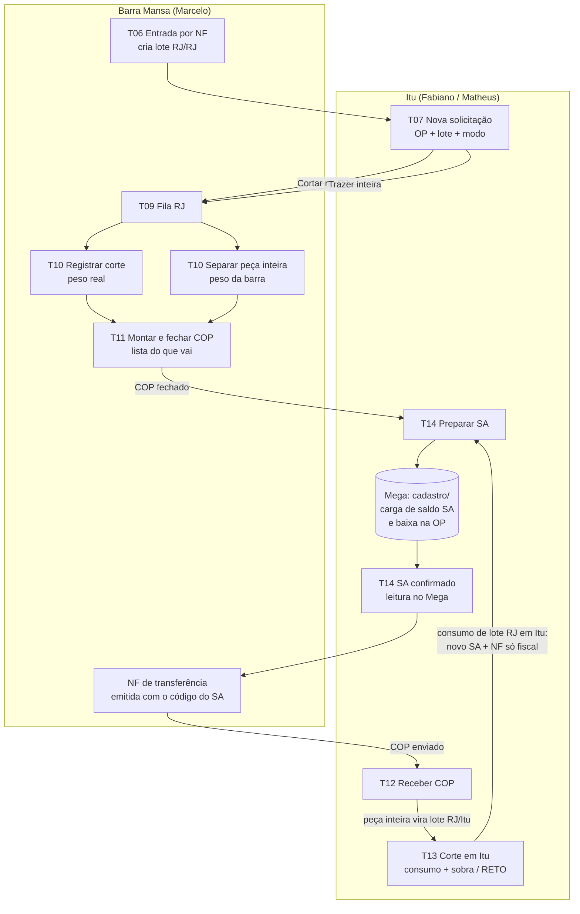
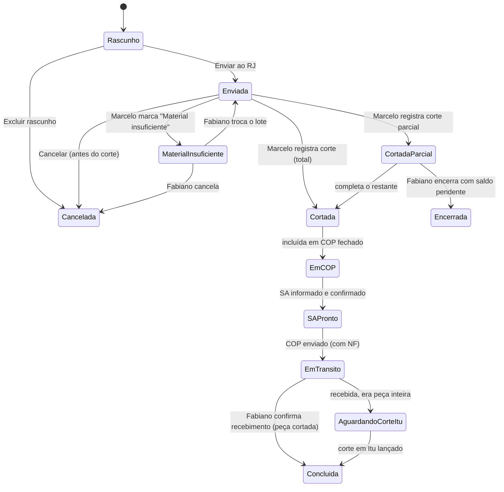

# EstoqueACK — Especificação Funcional Completa

Versão 3.4, 06/11/2026. A 3.4 registra a correção da auditoria de 06/11: T15 mínima e consulta "RETO por origem" entram na F1 (§4.2, T04, T15), a carga passa a quebrar o RETO do RJ em Itu por bitola de origem e a ler redondo com comprimento como redondo (§10.8), a T25 é linha de comando (não é tela), regras que só estavam no código ficam registradas como "a confirmar" (§9.1) e perguntas P19 a P25 (§12). A 3.3 registra as respostas do Fabiano ao BLOCO 1 da carga (§10.7: paridade sem múltiplo, material só do RJ sem código, kardex de 2 anos para códigos fora do catálogo). A 3.2 registra as decisões do Eduardo de 04/11 (T16 mínima e impressão da Fila RJ na F1; depois da implantação, planilhas só para conferência semanal, §10.6; sem data de implantação), as colunas da lista de corte impressa (R037), as interpretações da carga (R032, §10.7) e o R024 completo (perda de corte normal: até 6 % do material usado). A 3.1 registra as leituras do Mega confirmadas no R026 (situação da OP, SA pela estrutura da OP, confirmação do SA, NCM/IPI). A v3 incorpora as **respostas do Eduardo às perguntas P01–P18** (arquivo "Questões IA.xlsx", 2026-11-03) e as respostas do FUNCIONAL aos pedidos R003–R009, R014 e R017. A v2 tinha incorporado a conferência com as planilhas (`04_conferencia_planilhas_x_fluxo.md`) e as regras do Matheus. **Sem data fixa de implantação [P08]:** o sistema entra quando os critérios de go/no-go forem atendidos e o Eduardo liberar. Este documento descreve o sistema **como se ele já estivesse funcionando**: o que cada tela faz, quais botões existem, de onde vem cada informação e o que acontece no banco de dados a cada ação. Ele complementa `02_proposta_arquitetura.md`, que trata da parte técnica.

As decisões estão marcadas como **[P01]**, **[P02]** etc. e reunidas no fim (§12), já com a resposta.

---

## 1. Como ler este documento

### 1.1 Origem de cada informação

Cada campo das telas traz uma etiqueta que diz de onde vem o valor:

| Etiqueta | Significado |
|---|---|
| **[MEGA]** | Lido do banco Oracle do ERP Mega, somente leitura. Ex.: dados da OP, descrição do item, saldo do código Mega |
| **[LOTE]** | Herdado do lote escolhido. Ex.: contêiner, liga, bitola, planta |
| **[DIGITADO]** | O usuário digita ou escolhe |
| **[CALC]** | O sistema calcula. Ex.: peso previsto, saldo, % de sobremetal |
| **[SUGERIDO]** | O sistema preenche sozinho, mas o usuário pode alterar. Ex.: código de SA usado antes para o mesmo item |
| **[SISTEMA]** | Gerado automaticamente e não editável. Ex.: número do lote, data/hora, usuário |
| **[PLANILHA]** | Veio da carga inicial das planilhas (§10) |

### 1.2 Pessoas e perfis

| Perfil | Quem | Faz principalmente |
|---|---|---|
| Estoque Itu | Fabiano Camargo; Matheus Almeida como substituto | Solicita corte ou peça inteira, recebe COP, faz corte em Itu, lança sobra e RETO, prepara SA, faz ajustes |
| Operação RJ | Marcelo | Registra entrada por NF no RJ, executa cortes, informa peso real, monta e fecha COP |
| Análise | Renato Pinto | Consulta, relatórios, reservas e restrições, notas de compra |
| Administrador | Eduardo | Tudo, mais usuários, parâmetros, catálogo e auditoria |

### 1.3 Os três estoques

Todo lote tem uma **planta fiscal** e um **local físico**. A combinação dos dois define em qual estoque ele aparece:

| Estoque | Fiscal | Físico | Equivale na planilha a |
|---|---|---|---|
| Estoque Mega | Itu | Itu | Coluna "ESTOQUE MEGA" do Estoque Geral |
| RJ no Rio | RJ | RJ | ESTOQUE 2026 e coluna "ESTOQUE RJ (no Rio)" |
| RJ em Itu | RJ | Itu | Coluna "ESTOQUE RJ (em Itu)" |

---

## 2. Fluxo completo, do começo ao fim

O sistema tem cinco caminhos principais. Todos terminam com o material baixado na OP e rastreado até o contêiner de origem.

**Regra que vale para todo material RJ** (conferida nas planilhas, ver `04_conferencia_planilhas_x_fluxo.md` §1): o **SA + a NF de transferência** são o documento fiscal que leva o material do RJ para Itu. Por isso o SA é feito **antes do envio** do material (corte no RJ e peça inteira) ou **no consumo em Itu** (lote RJ em Itu), e **não depois do recebimento**. **Confirmado pelo Eduardo [P13]:** o cadastro de SA é feito **a partir das informações do COP**. A ordem é: corte → COP montado e fechado pelo RJ → SA em Itu → NF de transferência do RJ → envio. **Material só viaja com OP [P15].**



### 2.1 Caminho A: material RJ, cortado no RJ

Exemplo real: OP 100592, H13 33×105, CH33K.

1. **Fabiano** abre *Nova solicitação* (T07) e digita a OP. O sistema busca no Mega o item, o cliente e a medida acabada. Fabiano escolhe o lote H13 33×105 / CH33K e o modo **Cortar no RJ**. Ele informa quantidade, comprimento de corte e prazo. O sistema calcula o peso previsto e valida o sobremetal (§9). A solicitação fica **Enviada ao RJ**.
2. **Marcelo** vê a solicitação na *Fila RJ* (T09), corta e abre *Registrar corte* (T10). Ali informa peças cortadas e **peso real de balança**. Se precisou usar **outro lote ou dividir entre dois lotes**, ele informa isso ali (T10, "Usar outro lote / dividir"). O sistema valida a regra dos 5 % e **baixa o peso real do lote** (movimento `SAIDA_CORTE_RJ`). A solicitação fica **Cortada**.
3. **Marcelo** abre *COP* (T11), inclui os cortes prontos e **fecha o COP** nº 600 (a lista do que vai no caminhão, com peças e pesos). Os itens entram na **fila de SA** do Fabiano. A solicitação fica **Em COP**.
4. **Fabiano** abre *SA* (T14). O sistema já montou o pedido de SA de cada item do COP fechado, com material, dimensão, origem, quantidade e peso real. Se a peça acabada (item da OP) já teve SA, o sistema usa o mesmo código, seja qual for a bitola ou a MP. Só uma peça acabada que nunca teve SA exige cadastro novo (ver T14). Fabiano faz o cadastro ou a carga de saldo no Mega, como hoje, e informa o código do SA. O sistema confirma lendo o Mega. A solicitação fica **SA pronto**. Hoje isso acontece, em mediana, 1 dia antes do envio.
5. **RJ (Fio Certo / Médio Vale)** emite a **NF de transferência** com os SAs. Quando todos os itens do COP têm SA, **Marcelo** informa a NF (normalmente uma por COP; pode variar por item) e clica **"Enviar"**. Todas as solicitações do COP ficam **Em trânsito**.
6. **Fabiano** abre *Receber COP* (T12), confere item a item e confirma. A solicitação fica **Concluída**.

### 2.2 Caminho B: material RJ, peça inteira trazida para Itu

Exemplo real: OP 100092, H13 70×610, CH25K. A peça prevista pesa 837 kg, e a barra inteira, 1.288 kg.

1. **Fabiano** cria a solicitação com o modo **Trazer peça inteira**, escolhe o lote, informa **opcionalmente o comprimento da barra** quando souber (ex.: "H13 45×610×3905"; hoje essa informação vem por WhatsApp e não é obrigatória **[P14]**) e preenche o **sobremetal**. O sistema calcula o **peso previsto da peça** pela **bitola escolhida + sobremetal preenchido** (dimensões brutas de corte, ver T07), e não pela medida acabada. No exemplo, 837 kg. Esse peso vai para o SA e para a NF. *(Regra confirmada pelo Matheus em 2026-10-30.)*
2. **Marcelo**, em T10, separa a barra e informa o **peso da barra inteira** (1.288 kg) e, se quiser, o comprimento (campo opcional). O sistema baixa 1.288 kg do lote RJ/RJ e deixa esse peso **em trânsito**. Aqui a regra dos 5 % não se aplica, porque a barra é naturalmente maior que a peça. A regra dos 5 % é aplicada no passo 6, quando a peça é pesada.
3. **Marcelo** inclui a barra no COP (T11) e fecha o COP. A linha entra na fila de SA com o **peso previsto** (837 kg).
4. **Fabiano** faz o SA (T14) com o peso previsto. O RJ emite a NF de transferência (que leva só o peso do SA, 837 kg) e o Marcelo envia o COP.
5. **Fabiano** recebe o COP (T12). O sistema cria automaticamente um **lote RJ em Itu** de 1.288 kg, filho do lote original (mesmo contêiner, liga e bitola). Fiscalmente, 837 kg já foram para Itu pelo SA; o resto (451 kg) continua **fiscal RJ, físico Itu**, que é exatamente o "RJ em Itu" da planilha.
6. **Fabiano** corta em Itu e lança em *Corte em Itu* (T13): consumo da OP, sobra pesada e se a sobra **ainda está na bitola** 70×610. Exemplo: consumo 837 kg e sobra 446 kg, com perda de corte de 5 kg dentro da tolerância.
   - **Peso real da peça × previsto:** se o consumo pesado passar **mais de 5 %** do peso previsto calculado no passo 1, o sistema aponta (EXCESSO_TOLERANCIA) e **pede justificativa**. Exemplo de justificativa: "Peso maior por desvio de serra, aumentou o sobremetal no comprimento".
   - **Se a sobra ainda está na bitola**, ela fica no lote RJ em Itu.
   - **Se não está**, o sistema cria um **lote RETO** (RJ em Itu), filho do lote 70×610 / CH25K.
7. O SA já foi feito no passo 4. A solicitação fica **Concluída**. Se depois sobrar material dessa barra e ele for usado para a **mesma OP**, o consumo extra gera um SA complementar pelo Caminho B2 (nas planilhas: OP 99125, 195 kg + 117 kg).

### 2.2b Caminho B2: corte em Itu de material RJ em Itu (sobras e RETO que já estão em Itu)

Nas planilhas, é **45 % de todos os SAs** desde maio/2025 (649 de 1.438), e esse caminho não passa pelo Controle de Corte. Exemplo: em 2025-05-08, dezenas de OPs com H13 28×610 / CH31K, de 7 a 300 kg cada, NFs 556–558.

1. **Fabiano** lança em *Corte em Itu* (T13): OP, lote RJ em Itu (ou RETO RJ em Itu), consumo, sobra e se a sobra mantém a bitola.
2. Como o lote é **fiscal RJ**, o sistema cria automaticamente a linha na **fila de SA** (T14), com o consumo pesado, o material, a bitola (ou "RETO") e o contêiner de origem.
3. **Fabiano** faz o SA no Mega e informa o código. O **RJ emite a NF de transferência só fiscal** (o material não viaja), e o Fabiano informa o nº da NF no SA (várias linhas de SA podem usar a mesma NF).
4. A baixa na OP é feita no Mega com o código do SA, como hoje.

### 2.3 Caminho C: material Mega (fiscal e físico em Itu)

1. **Entrada:** a NF é lançada no Mega, como hoje. Na sincronização, o sistema detecta saldo novo no código Mega e cria uma pendência em *Entradas Mega a classificar* (T15, **versão mínima na F1**, decisão de 06/11). Fabiano informa o contêiner e escolhe **"Criar lote"** (o sistema cria o lote ITU/ITU **[P01]**) ou **"Não é entrada"** (com justificativa). Sem isso, a primeira NF de MP lançada no Mega depois da implantação deixaria o sistema diferente do Mega, e a única saída seria ajuste manual. A diferença que sobra aparece na T16 mínima.
2. **Uso:** Fabiano lança em *Corte em Itu* (T13): OP, lote, consumo e sobra, dentro ou fora da bitola. O sistema baixa o lote e, se for o caso, cria o lote RETO com a origem.
3. **ERP:** a baixa na OP e a transferência de saldo do código original para o código RETO continuam sendo feitas **no Mega**. O sistema mostra a instrução pronta, por exemplo: "Baixar 104,5 kg do código 78290 na OP 100508. Transferir 12,0 kg do código 78290 para o código 1698 (H13 RETO)". Depois, a *Conciliação* (T16) confere se o Mega bate.

### 2.4 Caminho D: entrada de material novo no RJ

**Marcelo** lança a NF de entrada em T06, com contêiner, itens, bitolas, peças e peso de cada item. Cada linha vira um **lote RJ/RJ** com saldo inicial igual ao peso informado.

---

## 3. Situações (estados) de cada documento

### 3.1 Solicitação de corte



| Situação | Quem altera | Efeito no estoque |
|---|---|---|
| Rascunho | Estoque Itu | Nenhum |
| Enviada | Estoque Itu | **Reserva** o peso previsto no lote: ele aparece como "reservado" e não está mais disponível para outras solicitações |
| Material insuficiente | Operação RJ (T09), com observação | Libera a reserva do que não foi cortado. O Fabiano decide em T08: **"Trocar lote"** (a mesma solicitação volta para *Enviada* com o novo lote e nova reserva) ou **"Cancelar"** **[R003]** |
| Cortada / parcial | Operação RJ | Baixa o **peso real** do lote (ou dos lotes, se dividiu) e libera a reserva do que foi cortado. A parcial continua na Fila RJ com o restante |
| Encerrada com saldo pendente | Estoque Itu (T08, botão "Encerrar com saldo pendente", justificativa) | Libera a reserva do restante. O que foi cortado segue normalmente para COP **[R004]**. No sistema não é uma situação à parte: a solicitação fica **Cortada** com a marca "encerrada com saldo pendente" e segue o fluxo normal **[R024]** |
| Em COP | Operação RJ, ao fechar o COP | Nenhuma. Entra na fila de SA |
| SA pronto | Estoque Itu, ao informar o código do SA (confirmado no Mega) | Nenhuma. Quando todos os itens do COP estão assim, o COP pode ser enviado |
| Em trânsito | Operação RJ, ao enviar o COP com a NF | Nenhuma mudança de saldo. O material fica "em trânsito" |
| Aguardando corte em Itu | Estoque Itu, ao receber peça inteira | Cria o lote RJ em Itu com o peso da barra |
| Concluída | Estoque Itu, ao receber (peça cortada) ou ao lançar o corte em Itu (peça inteira) | Fecha a rastreabilidade OP ↔ lote ↔ SA ↔ NF ↔ COP |
| Cancelada | Estoque Itu (antes do corte) | Libera a reserva. Depois do corte, é preciso usar o estorno (§8) |

### 3.2 COP

`Aberto` (Marcelo incluindo cortes prontos) → `Fechado` (lista conferida; os itens vão para a fila de SA de Itu **[P13]**) → `Aguardando NF` (todos os itens com SA pronto) → `Enviado / em trânsito` (Marcelo informa a NF e envia; normalmente uma NF por COP, pode variar por item) → `Recebido parcial` → `Recebido` (Fabiano). Um COP fechado não aceita mais itens. Para corrigir, Marcelo usa *Reabrir COP*, que exige justificativa e só vale enquanto nenhum item tiver SA confirmado.

### 3.3 SA

Nasce em dois momentos: **COP fechado** pelo RJ (uma linha por item do COP, inclusive peça inteira, com o peso previsto) **[P13]** ou **corte em Itu de lote fiscal RJ** (T13, Caminho B2).

`Pendente de preparo` → `Preparado` (dados conferidos e pedido exportado) → `Aguardando confirmação no Mega` (código informado) → `Confirmado` (o sistema achou o código e a carga no Mega). Se a confirmação não vier em 48 horas (configurável), o SA aparece em vermelho no painel.

### 3.4 Lote

`Ativo` → `Esgotado` (saldo zero, sai das listas padrão mas continua consultável). Um lote nunca é apagado.

**Peças [P11, P14]:** o controle é **em kg por lote**. A quantidade de barras/chapas é só informação. O **comprimento** é um campo **opcional** (na entrada, na solicitação de peça inteira e no corte), preenchido quando se souber, sem obrigação, porque hoje isso demanda tempo e mão de obra.

---

## 4. Navegação

```
Menu lateral (aparece conforme o perfil)
├── Painel                                (todos)
├── Estoque
│   ├── Consulta de estoque               (todos; abas: por lote, agrupado por item, RETO por origem)
│   └── Detalhe do lote                   (todos, abre a partir da consulta)
├── Barra Mansa
│   ├── Entrada por NF                    (Operação RJ)
│   ├── Fila RJ / Registrar corte         (Operação RJ; Estoque Itu só consulta)
│   └── COP                               (Operação RJ; Estoque Itu consulta e recebe)
├── Itu
│   ├── Solicitações de corte             (Estoque Itu)
│   ├── Receber COP                       (Estoque Itu)
│   ├── Corte em Itu (consumo/sobra/RETO) (Estoque Itu)
│   ├── SA                                (Estoque Itu)
│   └── Entradas Mega a classificar       (Estoque Itu)
├── Controle
│   ├── Conciliação com o Mega            (Estoque Itu, Análise)
│   ├── Reservas e restrições             (Estoque Itu, Análise)
│   ├── Ajuste de inventário / estorno    (Estoque Itu, com justificativa)
│   └── Relatórios                        (todos)
├── Calculadora de peso                   (todos)
└── Administração                         (Admin)
    ├── Usuários
    ├── Catálogo: ligas, densidades, itens de MP
    ├── Parâmetros (tolerâncias, prazos)
    └── Auditoria
```

A **carga inicial (T25) não é tela**: é linha de comando rodada pelo TÉCNICO no servidor (`python -m app.carga`), com prévia em Excel, uma vez na virada (§10).

### 4.1 Matriz perfil × tela [R009]

Legenda: **A** = usa e altera; **V** = só consulta; **—** = não aparece no menu. O perfil Operação RJ só enxerga lotes, solicitações e COPs do **RJ no Rio** **[P10]**.

| Tela | Estoque Itu (Fabiano, Matheus) | Operação RJ (Marcelo) | Análise (Renato) | Admin |
|---|---|---|---|---|
| T01, T01b, T02 Entrar / senha | A | A | A | A |
| T03 Painel | A (pendências de Itu) | A (pendências do RJ) | A (pendências de análise) | A |
| T04 Consulta de estoque (inclui a aba "RETO por origem") | V | V (só RJ no Rio) | V | V |
| T05 Detalhe do lote | A (notas, ajuste, atribuir origem) | V (só RJ no Rio) + notas | V + notas | A |
| T06 Entrada por NF (RJ) | V | A | V | A |
| T07 Nova solicitação | A | — | — | A |
| T08 Solicitações (lista) | A | V (as do RJ) | V | A |
| T09 Fila RJ | V | A | — | A |
| T10 Registrar corte | — | A | — | A |
| T11 COP | V | A | V | A |
| T12 Receber COP | A | V | — | A |
| T13 Corte em Itu | A | — | — | A |
| T14 SA | A | V (situação do SA dos itens do COP) | V + exportar + R$/kg | A |
| T15 Entradas Mega a classificar (mínima, F1) | A | — | V | A |
| T16 Conciliação Mega | A | — | V | A |
| T17 Reservas e restrições | A | V (lotes RJ no Rio) | A | A |
| T18 Ajuste / estorno | A | A (só estorno dos próprios lançamentos, antes do COP fechado) | — | A |
| T19 Relatórios | V | V (só RJ no Rio) | V | V |
| T20 Calculadora | A | A | A | A |
| T21 Usuários, T23 Parâmetros, T24 Auditoria | — | — | — | A |
| T22 Catálogo | V | — | V | A |
| T26 Material a chegar | V | — | A | A |

**Operação RJ não vê o que é de Itu em nenhum lugar [P10, detalhado em 06/11 após a auditoria].** Vale para o Painel (só pendências e totais do RJ no Rio), para a árvore de origem do T05 (filhos que estão em Itu não aparecem, nem seus saldos), para o T14 (só os SAs dos itens dos COPs do RJ; os SAs de corte em Itu, Caminho B2, não aparecem), para as exportações e para a aba "RETO por origem".

Em todas as telas há uma busca global no topo. Ela aceita um número de OP, de lote (L-000123), de COP, de SA ou de contêiner (CH11EA) e abre direto o item encontrado.

### 4.2 O que entra na F1 e o que fica para a F1.1 (resumo, atualizado em 06/11)

| Tela | F1 | F1.1 |
|---|---|---|
| T15 Entradas Mega a classificar | **Mínima (entra na F1 desde 06/11)**: lista, "Criar lote", "Não é entrada" | Nada previsto além disso |
| T16 Conciliação com o Mega | Mínima, só leitura (decisão de 04/11); mostra a diferença **explicada** pela T15 | "Ver movimentos", "Ajustar lote", "Marcar como explicada" |
| Consulta "RETO por origem" (aba do T04) | **Entra na F1 (06/11)** | T19 completo (rastreio por OP, por contêiner, histórico) |
| T19 Relatórios (os 9) | — | Todos |
| T26 Material a chegar | — | Sim |
| T25 Carga inicial | Linha de comando, não é tela | — |

(O plano de etapas e o go/no-go ficam em `coordenacao/ESTADO_COORDENACAO.md`; esta tabela só diz o que cada tela tem de funcionalidade.)

---

## 5. Telas, uma a uma

Padrão de todas as telas: cada botão tem um nome que diz o que faz. As validações aparecem **antes** de gravar, em três cores:

- **vermelho:** bloqueia;
- **amarelo:** exige "estou ciente" e justificativa;
- **cinza:** é só um aviso.

Toda gravação gera um registro na auditoria com usuário, data/hora e IP.

### T01. Entrar

| Campo | Origem |
|---|---|
| Login | [DIGITADO] |
| Senha | [DIGITADO] |

| Manter conectado | [DIGITADO] caixa de seleção. Sessão de 30 dias; o sistema **não** guarda a senha (o navegador pode guardar) |

**Botão "Entrar":** se der certo, abre o Painel. Se a senha for temporária ou o admin marcou "obrigar troca", abre T02. Depois de 5 erros seguidos, a conta fica bloqueada por 15 minutos. O acesso só é aceito a partir dos IPs da empresa.

**Link "Esqueci minha senha"** abre T01b. **[R014]**

### T01b. Esqueci minha senha / Criar nova senha [R014]

- **"Esqueci minha senha":** campo login **ou** e-mail [DIGITADO]. **Botão "Enviar link".** A resposta é sempre a mesma frase, exista ou não o usuário (para não revelar quem existe). O e-mail sai de `estoque.smtp@acokorte.com.br` pelo Microsoft Graph, com um link válido por **30 minutos e uso único**.
- **"Criar nova senha":** aberta pelo link. Campos nova senha e repetição [DIGITADO]. **Botão "Salvar nova senha".** Link vencido ou já usado mostra "Pedir um novo link".

### T02. Trocar senha

Campos: senha atual, nova senha e repetição da nova [DIGITADO]. **Botão "Salvar nova senha".** A senha precisa ter **pelo menos 6 caracteres**, sem outra exigência (pode ser só números) **[R017]**.

### T03. Painel

O que aparece depende do perfil.

- **Barra de estoque:** total em kg e divisão entre Estoque Mega, RJ no Rio e RJ em Itu [CALC, a partir dos saldos dos lotes].
- **Minhas pendências:** lista clicável.
  - *Estoque Itu:* **SAs pendentes que estão segurando COP no RJ** (no topo), COPs em trânsito para receber, peças inteiras aguardando corte em Itu, SAs sem confirmação, entradas Mega a classificar.
  - *Operação RJ:* fila de corte por prazo, cortes aguardando SA de Itu, cortes com SA pronto fora de COP, COP aberto.
  - *Análise:* lotes com reserva vencendo, divergências com o Mega, exceções de tolerância da semana.
- **Atrasos:** solicitações com a mesma regra da planilha atual: até 7 dias Normal, até 15 dias Atenção, acima disso Atrasado [CALC, data de envio × hoje].
- **Divergências com o Mega:** quantidade de códigos cuja soma dos lotes ITU/ITU difere do saldo do Mega acima de X kg [CALC + MEGA].
- **Última sincronização com o Mega:** data/hora e situação [SISTEMA].

### T04. Consulta de estoque

Filtros (todos [DIGITADO]):

- estoque (Mega / RJ no Rio / RJ em Itu / todos);
- liga;
- bitola (espessura, largura ou diâmetro, com faixa "de/até");
- formato (retangular / redondo / RETO);
- contêiner;
- código Mega;
- "somente com saldo";
- "somente com reserva ou restrição";
- "somente origem não identificada".

**Visibilidade [P10]:** o perfil **Operação RJ** (Marcelo) vê **somente o estoque RJ no Rio**; o filtro "estoque" fica travado. Os demais perfis veem os três estoques.

**Material a chegar [P17]:** na visão *agrupado por item*, uma coluna "A chegar (kg)" soma os pedidos abertos de T26 e abre a lista ao clicar.

**Modos de visão:** *por lote* (uma linha por lote), *agrupado por item* (soma por liga + bitola, parecida com o Estoque Geral de hoje) e a aba ***RETO por origem*** (abaixo, entra na F1).

| Coluna | Origem |
|---|---|
| Lote | [SISTEMA] |
| Contêiner | [LOTE] |
| Liga / bitola / descrição | [LOTE] → catálogo |
| Código Mega | [LOTE] → catálogo [MEGA] |
| Estoque | [CALC] fiscal × físico |
| Saldo kg | [CALC] soma dos movimentos |
| Reservado kg | [CALC] solicitações enviadas + reservas |
| Disponível kg | [CALC] saldo − reservado |
| Origem | [CALC] contêiner/bitola raiz, para lotes SOBRA e RETO |
| Indicadores | Ícone de reserva/restrição, nota do Renato, origem não identificada |

Botões:

- **"Exportar para Excel":** gera a lista filtrada.
- **"Nova solicitação com este lote":** só para Estoque Itu; abre T07 com o lote preenchido.
- Clicar numa linha abre T05.

#### T04 aba "RETO por origem": quantos kg de RETO vieram de cada bitola e contêiner **[auditoria 06/11, decisão do Eduardo: entra na F1]**

É a pergunta que motivou o projeto. **Onde fica (proposta, P25):** aba dentro da T04, ao lado de "por lote" e "agrupado por item", porque reaproveita os filtros, a regra de visibilidade (P10) e o botão de exportar. O T19 completo (relatório 2, rastreio por OP e por contêiner, histórico no período) continua na F1.1.

**Quem acessa:** Estoque Itu, Análise e Admin veem Estoque Mega e RJ em Itu. **Operação RJ (Marcelo) vê só o RJ no Rio, com o filtro de estoque travado [P10]**; como no RJ no Rio não existe lote RETO (a sobra fica na linha do contêiner), a aba mostra "Nenhum RETO no RJ no Rio" e nunca mostra RETO de Itu.

**Filtros:** estoque (Mega / RJ em Itu / todos); liga (uma ou várias); bitola de origem (de/até e texto, ex.: "45x610"); contêiner de origem; código Mega; "somente com saldo" (ligado por padrão); "incluir sobras com bitola original (SOBRA)" (desligado por padrão: só RETO); "criado entre" (data do lote RETO).

**Linhas (agrupadas Liga → Bitola de origem → Contêiner de origem; clicar abre os lotes, e o lote abre a T05):**

| Coluna | Origem |
|---|---|
| Liga | [LOTE] → catálogo |
| Bitola de origem | [CALC] bitola do lote **raiz** da árvore de origem (RETO que nasce de RETO continua apontando para a raiz), ou a bitola lida do comentário da carga (§10.8) |
| Contêiner de origem | [CALC] contêiner do lote raiz; "não informado" quando só se sabe a bitola |
| Estoque | [CALC] Estoque Mega ou RJ em Itu |
| Nº de lotes | [CALC] |
| Saldo kg | [CALC] soma dos movimentos dos lotes RETO |
| Reservado / Disponível kg | [CALC], como na T04 |

**Três classes de origem, sempre separadas, nunca somadas dentro de uma bitola:** (1) *origem completa* (bitola e contêiner); (2) *só a bitola* (vindo dos comentários do Estoque Geral); (3) ***Sem origem*** (origem não identificada: RETO do Mega que veio da carga e RETO do RJ em Itu sem comentário). A classe 3 aparece em **linha própria por liga** ("Sem origem identificada"), abaixo das linhas com origem, e é a que o botão "Atribuir origem" (T05) vai reduzindo com o tempo.

**Totais:** subtotal por liga (com origem / só bitola / sem origem / total da liga) e total geral no rodapé, no formato "Com origem X kg · Só bitola Y kg · Sem origem Z kg · Total RETO W kg". O total geral é igual à soma dos saldos dos lotes tipo RETO nos filtros aplicados (é o número que deve bater com a T04 filtrada por formato RETO).

**Exportar para Excel:** duas abas, "Resumo" (as linhas agrupadas e os totais) e "Lotes" (um lote por linha: lote, estoque, liga, bitola e contêiner de origem, classe de origem, saldo, reservado, data de criação, nota). O cabeçalho do arquivo traz os filtros usados e a data/hora.

### T05. Detalhe do lote

Seções da tela:

1. **Cabeçalho:** lote, contêiner, liga, bitola, estoque, saldo, reservado, disponível, peso e peças iniciais, NF de entrada, data de entrada.
2. **Árvore de origem:** do lote original até os filhos (sobras e RETO), cada um com seu saldo.
3. **Movimentos:** data, tipo, kg (+/−), OP, COP, SA, usuário e justificativa, em ordem cronológica, com saldo acumulado.
4. **Reservas e restrições** vigentes.
5. **Notas:** comentários do Renato e de outros usuários.

Botões:

- **"Adicionar nota"**: todos.
- **"Adicionar reserva ou restrição"**: Estoque Itu e Análise; abre T17.
- **"Ajustar saldo"**: Estoque Itu; abre T18.
- **"Imprimir ficha do lote"**: PDF com o resumo.

### T06. Entrada por NF (Barra Mansa)

Quem usa: Marcelo. Objetivo: registrar o material que chega ao RJ e criar os lotes RJ/RJ.

| Campo | Origem | Regra |
|---|---|---|
| Nº da NF, data, fornecedor | [DIGITADO] | Bloqueia se a NF + fornecedor já tiver sido lançada |
| Contêiner | [DIGITADO], com lista dos já existentes | Se não existir, cria; se existir, adiciona itens ao contêiner |
| Itens (várias linhas) | — | — |
| ↳ Liga | [DIGITADO] lista do catálogo | — |
| ↳ Formato e bitola | [DIGITADO] | — |
| ↳ Descrição como na NF | [DIGITADO] | O sistema interpreta e sugere liga/bitola [SUGERIDO] |
| ↳ Quantidade de barras/chapas | [DIGITADO] | — |
| ↳ Peso (kg) | [DIGITADO] | Peso da NF/balança |
| ↳ Comprimento | [DIGITADO], opcional | Ex.: "2800–6000" |
| ↳ Valor R$/kg | [DIGITADO], opcional | Fora do foco inicial |
| ↳ Peso teórico | [CALC] | Aviso cinza se diferir do peso informado em mais de 20 % (possível erro de digitação) |

Botões:

- **"Adicionar item".**
- **"Salvar entrada":** cria um lote por linha (movimento `ENTRADA`).
- **"Cancelar".**

Depois de salvar, a entrada só pode ser corrigida por estorno (T18).

### T07. Nova solicitação de corte

Quem usa: Fabiano e Matheus. É um assistente em quatro passos.

**Passo 1, OP:**

| Campo | Origem |
|---|---|
| Nº da OP | [DIGITADO] |
| Item (código e descrição) | [MEGA] pela OP |
| Cliente | [MEGA] pela OP |
| Situação da OP | [MEGA] (`ORD_ST_SITUACAO`). **Encerrada (EN) ou Cancelada (CA): bloqueia.** **Aberta (AB): aceita.** **Firme planejada (FP), Liberada (LB), Planejada (PL) ou Simulada (SI)**, ou seja, ainda não aberta no Mega: **só avisa** (`OP_NAO_ABERTA`, cinza) e deixa seguir, **em todas as telas** (T07, T13, T14). Decisão do Eduardo em 2026-11-03 **[R026]** |
| Quantidade da OP | [MEGA] |
| MP prevista na estrutura | [MEGA], só informativo. Você informou que geralmente não é a correta |
| Medida acabada (E × L × C ou Ø × C) | [SUGERIDO] da descrição do item no Mega, editável |
| Comprimento fixado / múltiplo do item | [LOTE] → catálogo (vem da coluna "COMPR. FIXADOS" do Estoque Geral, ex.: "MULT. 1820", "3110MM (MIN)"). Só informativo |
| Histórico desta OP | [CALC] solicitações e SAs já existentes. Amarelo se já houver |

**Passo 2, lote:** o sistema lista os **lotes compatíveis**: mesma liga, bitola capaz de comportar a medida acabada e saldo disponível. A ordem é: menor sobremetal primeiro, depois o lote mais antigo. Para cada lote aparecem estoque, saldo disponível, % de sobremetal estimado e um ícone de reserva ou restrição. O usuário escolhe um lote. Para usar mais de um lote na mesma OP, ele adiciona um segundo, como no caso da OP 100553 (21×202 do CH11EA e 21×203 do CH40SH). No modo **peça inteira**, o usuário pode informar o **comprimento da barra** (opcional) **[P14]**. Lotes de **liga equivalente** (ex.: 1.2344 para H13) aparecem com o selo "liga equivalente" e pedem "estou ciente" **[P18]**. Item de MP marcado como **"substituído por"** no catálogo mostra o aviso e sugere o substituto.

**Passo 3, corte:**

| Campo | Origem | Regra |
|---|---|---|
| Modo | [DIGITADO]: Cortar no RJ / Trazer peça inteira / Cortar em Itu (lote em Itu) | O modo depende do local físico do lote |
| Quantidade de peças | [SUGERIDO] da quantidade da OP | — |
| Sobremetal no comprimento (mm) | [SUGERIDO] 5 mm, editável | Padrão confirmado nas planilhas: 5 mm em 280 de 394 instruções |
| Sobremetal na largura (mm) | [SUGERIDO] 5 mm quando a peça sai de chapa larga; 0 quando usa a largura inteira da barra | Editável |
| **Dimensões brutas de corte (E × L × C ou Ø × C)** | [CALC] **espessura (ou Ø) = da bitola**; **largura = da bitola** se a peça usa a largura inteira, senão largura acabada + sobremetal; **comprimento = acabado + sobremetal**. Cada uma editável | É o "bitola escolhida + sobremetal preenchido" do Matheus. Ex.: OP 91050, peça 23×65×165,2 de bitola 28×610 → bruto ≈ 28 × 70 × 170 |
| Comprimento de corte por peça (mm) | [CALC] = comprimento bruto | — |
| Instrução para o RJ | [SUGERIDO] "12 PEÇAS COM 255MM COMPRIMENTO" ou "TRAZER 01 PEÇA H13 70X610" | Mesmo texto usado hoje |
| Peso da peça acabada | [CALC] medida acabada × densidade da liga | Só referência para o sobremetal % |
| Peso previsto | [CALC] **dimensões brutas de corte** × quantidade × densidade | Base da regra dos 5 % na pesagem (T10 no corte RJ; T13 na peça inteira e no corte em Itu). Na **peça inteira**, é o peso que vai para a NF e o SA |
| Sobremetal % | [CALC] (previsto − peça acabada) / peça acabada | Acima de 20 %: amarelo, justificativa obrigatória |
| Prazo | [SUGERIDO] da data de entrega da OP [MEGA], editável | — |
| Comprimento da barra (peça inteira) | [DIGITADO], **opcional** **[P14]** | Só informação; vai para a instrução "TRAZER 01 PEÇA H13 45X610X3905" quando preenchido |
| Instrução de processo | [DIGITADO], com opções rápidas "Retificar espessura", "Retificar largura", "Peça bipartida", "Usar sobras" | Aparece na Fila RJ e na lista de corte impressa (hoje são notas do almoxarifado nas células) |
| Observação | [DIGITADO] | — |

**Passo 4, revisão:** resumo, painel de validações e campos de justificativa para cada item amarelo.

Botões:

- **"Salvar rascunho".**
- **"Enviar ao RJ":** a solicitação fica *Enviada* e reserva o peso previsto no lote. Marcelo é notificado.
- **Modo "Cortar em Itu" [R005]:** não cria solicitação nem reserva. Quando o lote escolhido está em Itu, os botões "Salvar rascunho" e "Enviar ao RJ" não aparecem; o único botão é **"Registrar corte em Itu agora"**, que abre T13 já com a OP, o lote e o peso previsto preenchidos.

### T08. Solicitações de corte (lista)

Filtros: situação, OP, cliente, liga, contêiner, período, "somente atrasadas".

Colunas: data, OP, item, cliente, MP/bitola, contêiner, modo, quantidade, peso previsto, peso real, prazo, situação com a cor do atraso, COP.

Botões:

- **"Nova solicitação".**
- **"Exportar".**
- Na linha: **"Abrir"**, **"Cancelar"** (só antes do corte) e **"Duplicar"** (cria outra solicitação parecida, útil para OPs do mesmo item).
- **"Trocar lote"** e **"Cancelar"** para solicitação em *Material insuficiente* **[R003]**.
- **"Encerrar com saldo pendente"** para solicitação *Parcial*: só Estoque Itu, com justificativa; libera a reserva do restante **[R004]**.
- **"Trocar OP"** **[R007]**: só Estoque Itu, com justificativa. Pode ser usado até o SA ser confirmado no Mega. Troca OP, item e cliente da solicitação e da linha de SA pendente; o COP e os movimentos de lote não mudam (a OP nova passa a aparecer neles). Depois do SA confirmado, a troca continua possível, mas gera o aviso "ajustar o SA no Mega" e fica no relatório de exceções. Casos reais: "99588 deveria ter pedido material A8 comum… anexamos essas outras 20 peças na OP 99788".

### T09. Fila RJ

Quem usa: Marcelo. É a lista das solicitações *Enviadas* e *Parciais*, ordenada por prazo, com a cor de atraso. Ela funciona bem no tablet ou no celular.

Colunas: OP, item, cliente, MP, contêiner, instrução de corte, quantidade, prazo, dias em aberto.

Botões:

- **"Registrar corte"**: abre T10.
- **"Material insuficiente"**: marca a solicitação, notifica o Fabiano e exige observação (caso "MAT. INSUFICIENTE" da planilha).
- **"Imprimir lista de corte"** (**F1**, decisão de 04/11: o RJ trabalha com a lista impressa) **[R037]**: folha A4 deitada, sem menu, na mesma ordem da tela (por prazo). Colunas: **OP**; **material e contêiner**; **instrução de corte** (com a instrução de processo e a marca "peça inteira"); **quantidade** (ou "faltam X de Y" na parcial); **prazo**; **dias em aberto** (com "!" se atrasada); **item e cliente**; e duas colunas **em branco, "Peças cortadas" e "Peso real (kg)"**, para o operador anotar à mão na máquina. Depois, o Marcelo passa as anotações para o T10.

### T10. Registrar corte (RJ)

| Campo | Origem | Regra |
|---|---|---|
| Dados da solicitação | [SISTEMA] da solicitação | Só leitura |
| Lote usado | [LOTE] da solicitação; pode ser trocado ou dividido pelo botão abaixo | Nas planilhas, 14 % dos consumos saíram de contêiner diferente do pedido |
| Comprimento da barra (peça inteira) | [DIGITADO], opcional **[P14]** | — |
| Peças cortadas | [DIGITADO] | Aviso se for maior que o solicitado; menor deixa a solicitação parcial |
| Peso real (kg) | [DIGITADO], balança. Peça inteira: peso da barra inteira | Corte: acima de 5 % do bruto previsto, justificativa obrigatória; abaixo de 20 %, aviso. Peça inteira: bloqueia se for maior que o saldo do lote |
| Data do corte | [SISTEMA] hoje, editável para até 7 dias atrás | — |
| Observação | [DIGITADO] | — |

Botões:

- **"Usar outro lote / dividir"**: adiciona linhas com outro lote (mesma liga, bitola que comporte a peça), cada uma com peças e peso. Exige justificativa e notifica o Fabiano. Cada lote gera a sua linha de SA, como já acontece na planilha (ex.: "CH40SH - 16 PEÇAS 630,5KG / CH11EA - 4 PEÇAS 156,5KG").
- **"Confirmar corte"**: movimento `SAIDA_CORTE_RJ` em cada lote usado, com o peso real negativo e a reserva liberada. A solicitação fica *Cortada* e aparece em "Adicionar cortes prontos" no COP.
- **"Voltar".**

### T11. COP

**Lista de COPs:** número, data, situação, quantidade de itens, peso total e NF.

**Tela do COP aberto:**

| Campo | Origem |
|---|---|
| Nº do COP | [SUGERIDO] próximo número da sequência (último importado foi 600), editável |
| Itens | [DIGITADO] marcando os cortes prontos (inclusive peças inteiras separadas) que ainda não estão em COP |
| SA de cada item | [SISTEMA] situação do SA em Itu (pendente / pronto). Visível depois de fechar o COP |
| Peso total | [CALC] |
| NF de transferência | [DIGITADO] **uma vez no COP**, com o emitente (Fio Certo / Médio Vale), e copiada para todos os itens. Esse é o caso comum: 27 de 38 COPs de 2026 tiveram uma única NF. Exceção: botão "NF diferente para itens selecionados"; uma mesma NF também pode ser usada em dois COPs seguidos (3 casos em 2026). Fica gravada em cada linha de SA. Equivale à coluna "NF FIOCERTO/MEDIO VALE" da planilha de SA |
| Data de envio | [SISTEMA] ao enviar |

Botões:

- **"Novo COP".**
- **"Adicionar cortes prontos".**
- **"Remover item".**
- **"Fechar COP":** fecha a lista. Os itens entram na fila de SA de Itu e o Fabiano é notificado **[P13]**.
- **"Enviar":** só fica ativo quando todos os itens têm SA pronto e a NF está informada. Os itens ficam *Em trânsito* e o Fabiano é notificado.
- **"Imprimir romaneio":** PDF com OP, item, MP, contêiner, peças e peso.
- **"Reabrir COP":** só enquanto nenhum item tiver SA confirmado; exige justificativa.

### T12. Receber COP

Quem usa: Fabiano e Matheus. A tela mostra os COPs *Em trânsito*. Ao abrir um, aparece a lista de itens com uma caixa de conferência por linha.

| Campo por item | Origem | Regra |
|---|---|---|
| OP, MP, contêiner, peças, peso enviado | [SISTEMA] do COP | — |
| Recebido | [DIGITADO] caixa de seleção | — |
| Peso conferido em Itu (kg) | [DIGITADO], opcional | Se diferir do enviado em mais de 2 %, amarelo com justificativa. É registrado como divergência de transporte |

Botões:

- **"Confirmar recebimento"** (dos itens marcados).
- **"Registrar divergência"** **[R006]**: campos tipo (faltando / danificado / peso diferente), peças, kg e observação [DIGITADO]. Notifica o Marcelo.

Regras **[R006]**: item **não marcado** continua *Em trânsito* e o COP fica *Recebido parcial*. Item **faltando** continua *Em trânsito* até chegar ou até virar estorno com justificativa. A divergência de peso acima de 2 % **não bloqueia**: o item é recebido com justificativa e entra no relatório de exceções.

Efeitos:

- **Peça cortada:** fica *Concluída* (o SA já foi feito antes do envio).
- **Peça inteira:** o sistema cria o **lote RJ em Itu**, filho do lote de origem, com o peso recebido (movimento `RECEBIMENTO_ITU`). A solicitação fica *Aguardando corte em Itu*.

### T13. Corte em Itu (consumo, sobra e RETO)

Quem usa: Fabiano e Matheus. Vale para lotes **RJ em Itu** (peças inteiras e sobras) e **Estoque Mega**.

| Campo | Origem | Regra |
|---|---|---|
| OP | [DIGITADO] → item e cliente [MEGA] | Mesmas validações de T07 |
| Lote | [DIGITADO] ou [SUGERIDO] (peça inteira recebida para a OP) | — |
| Peso do lote antes | [CALC] saldo atual | — |
| Peso do material usado | [DIGITADO], **opcional**; padrão = saldo do lote **[R024]** | Para lote grande (ex.: 5 t de um código Mega), informa só o peso da barra ou pedaço que foi para a serra, senão a perda não fecha |
| Peças produzidas | [DIGITADO] | — |
| Consumo da OP (kg) | [DIGITADO], balança | Regra dos 5 % sobre o peso previsto da solicitação (bitola + sobremetal). Acima → justificativa (ex.: desvio de serra) |
| Sobra (kg) | [DIGITADO], balança | 0 se não houver |
| A sobra mantém a bitola original? | [DIGITADO] Sim / Não | Não → cria lote RETO |
| Perda de corte | [CALC] material usado − consumo − sobra | Amarelo ("estou ciente" com justificativa) se passar de **6 % do peso do material usado** (`PERDA_CORTE_MAX_PCT`, T23). Decisão do Eduardo, 2026-11-04 **[R024]**. Ex.: barra de 1.288 kg → até 77,3 kg de perda é normal |
| Reservas/restrições do lote | [LOTE] | Amarelo, exige "estou ciente" |

O sistema mostra o resultado antes de gravar. Exemplo: "Lote L-000451 passa de 1.288,0 kg para 0 kg. Novo lote RETO L-000452 com 446,0 kg, origem H13 70×610 / CH25K."

Botões:

- **"Confirmar"**: grava os movimentos `CONSUMO_OP`, `GERA_RETO` e `GERA_SOBRA`.
- **"Cancelar".**

Para lote **fiscal RJ** (RJ em Itu, inclusive RETO), ao confirmar, o sistema cria a linha na **fila de SA** com o consumo, a bitola (ou "RETO") e o contêiner de origem (Caminho B2, §2.2b). Se o lote veio de uma peça inteira cujo SA já foi feito com o previsto, o sistema liga o consumo a esse SA em vez de criar outro.

Para lote Mega, depois de confirmar, aparece um quadro **"Fazer no Mega"** com a baixa na OP (**consumo + perda de corte**, para o saldo do Mega bater com o lote **[R024]**) e a transferência para RETO já descritas, e o botão **"Copiar instrução"**.

### T14. SA

**Fila:** uma linha por OP + lote, com situação (Pendente / Preparado / Aguardando Mega / Confirmado). As linhas nascem de dois lugares: **COP fechado** pelo RJ (T11; os dados do SA vêm do COP **[P13]**) e **corte em Itu de lote fiscal RJ** (T13). A fila mostra no topo os COPs que estão **aguardando SA** para serem enviados.

**Pedido de SA**, com os mesmos campos da planilha atual:

| Campo | Origem |
|---|---|
| Data | [SISTEMA] |
| OP | [SISTEMA] da solicitação |
| Cliente | [MEGA] pela OP |
| Código do item | [MEGA] pela OP |
| Material | [LOTE] liga |
| Dimensão | [LOTE] bitola, ou "RETO" se o lote for RETO |
| Origem (contêiner) | [LOTE] |
| Quantidade | [SISTEMA] peças cortadas/produzidas |
| Peso | [CALC] peso previsto (bitola + sobremetal) para peça inteira, ou peso real do corte para corte no RJ [P03] |
| R$/kg | [DIGITADO], **manual e opcional** **[P16]**. Preenchido por quem cuida do custo, como hoje; o sistema não calcula |
| Valor precificador | [CALC] R$/kg × peso ÷ quantidade, quando o R$/kg estiver preenchido |
| Código Mega do SA | [MEGA] 1º o **SA da estrutura da OP** no Mega (o Mega já põe o SA como componente da OP de material RJ, ex.: OP 100592 → 37983) **[R026]**; se não houver, [SISTEMA] o código **mais recente e ativo** já usado para o **item da peça acabada**. Ver regra abaixo |
| Descrição | [SUGERIDO] "SA <descrição do item [MEGA]> - CÓD.<item>" ou a do SA anterior |
| NCM, IPI | [MEGA] NCM do cadastro do produto e IPI pela alíquota do NCM no Mega **[R026]**. Se o IPI do Mega for diferente do usado no histórico do item, aviso cinza (ex.: NCM 82089000: 5,2 % no Mega × 0,08 na planilha) |
| ICMS | [SUGERIDO] do SA anterior do mesmo item (o Mega não guarda ICMS no produto) |
| Pedido | [MEGA] pedido de venda da OP, se disponível; senão [DIGITADO] |
| NF de transferência | Corte no RJ e peça inteira: [SISTEMA] do item do COP, quando o Marcelo informar. Corte em Itu de lote RJ (B2): [DIGITADO] pelo Fabiano, com o emitente. Uma NF pode servir várias linhas |

**Regra do código de SA** *(confirmada pelo Matheus em 2026-10-30)*: o código de SA pertence ao **item da peça acabada**, que é o item que vem na OP. A bitola, a liga e a matéria-prima **não importam**.

- **A peça acabada já teve SA:** o código é o mesmo, preenchido pelo sistema, mesmo que a bitola ou a MP agora sejam outras. Não há cadastro novo.
- **A peça acabada nunca teve SA:** só nesse caso é preciso **criar um SA novo** no Mega. A linha aparece como "SA novo – cadastrar no Mega", e o código é [DIGITADO] depois do cadastro.
- **O item tem mais de um código no histórico** (100 dos 2.787 itens de 2016 a 2026, quase sempre porque o antigo foi inativado: "39294 - INAT"): o sistema usa o mais recente **ativo no Mega** e mostra os outros. Trocar o código exige justificativa.
- **Comprovado nas planilhas:** 889 itens usaram o mesmo código de SA com bitolas diferentes.
- **Fonte do vínculo item → SA:** 1º a estrutura da OP no Mega; depois a carga da planilha de SA e os SAs confirmados no sistema. Se a estrutura e o histórico trouxerem códigos diferentes, o sistema usa o da estrutura e mostra o outro **[R026]**.
- **SA inativo no Mega** (descrição "… INATIVO"): pede "estou ciente" com justificativa (`SA_INATIVO_MEGA`) e **nunca é confirmado**; na prática, é preciso cadastrar um SA novo. **Código que não existe no Mega:** aviso `SA_NAO_ENCONTRADO_MEGA` até aparecer **[R026]**.

Botões:

- **"Marcar como preparado".**
- **"Exportar pedidos selecionados"** (Excel, no mesmo layout da planilha de SA, para facilitar o lançamento no Mega).
- **"Informar código do SA".**
- **"Verificar no Mega agora"**: lê o Mega e confirma o SA. **Regra de confirmação [R026]:** o SA está confirmado quando o Mega tem a **carga do SA**, que é uma **entrada por compra (TPM 1) na filial 13, em peças, com a NF Fio Certo / Médio Vale** (ex.: 3215), seguida da transferência 13 → 3. Até maio/2026 a entrada era direto na filial 3, e as duas formas valem. Se a NF da entrada no Mega for diferente da NF informada no COP/SA, aviso cinza.
- **"Exportar SAs novos para o Renato"**: exporta (Excel, layout da planilha de SA) só as linhas ainda não exportadas e grava a data. Substitui o comentário "até esta linha foi baixado para computador Renato". Uma alteração em linha já exportada avisa o Renato.

Uma OP com dois lotes gera duas linhas com o mesmo código de SA, como já acontece hoje.

### T15. Entradas Mega a classificar (versão mínima, entra na F1 desde 06/11)

**Para que serve (Caminho C, passo 1):** quando uma NF de MP entra no Mega em Itu, o saldo do código sobe, mas o sistema ainda não tem o lote. A T15 deixa o operador transformar essa diferença em lote ou dizer que ela não é entrada, para que o sistema continue igual ao Mega. Na T16 mínima a diferença que o operador explicar aparece como explicada.

**Quem usa:** Estoque Itu (Fabiano, Matheus) e Admin alteram; Análise só consulta; Operação RJ não vê a tela. Aparece no menu Itu e como contador no Painel ("Entradas Mega a classificar: N").

**Quando nasce uma pendência.** Na sincronização (6h, 13h e "Sincronizar agora"), para cada código Mega do catálogo (filial 3, só Estoque Mega): `diferença = saldo Mega − soma dos saldos dos lotes ITU/ITU ativos − diferenças já explicadas ("Não é entrada")`. Se a diferença for **maior que `DIVERGENCIA_MEGA_KG`** (T23, 5 kg), existe uma pendência **por código** (a pendência é atualizada a cada sincronização, não duplicada). Diferença **negativa** (Mega menor que os lotes) não é da T15: aparece só na T16 e se corrige pelo T18. Código que o Mega tem e o catálogo não tem aparece com a etiqueta **"Código novo"** (ver "Criar lote").

| Campo da lista | Origem |
|---|---|
| Código e descrição | [MEGA] |
| Saldo Mega × soma dos lotes | [MEGA] × [CALC] |
| Diferença kg | [CALC] |
| Última entrada no Mega (NF, data, kg) | [MEGA], movimentos de entrada por NF **[P01]**; "não disponível" se a leitura falhar |
| Há quanto tempo | [CALC] desde a 1ª sincronização em que a diferença apareceu |
| Etiquetas | "Código novo" (sem item no catálogo); "Código RETO" (ver abaixo) |

Ordem padrão: mais antiga primeiro. Filtro: situação (Aberta / todas) e busca por código ou descrição.

**Botão "Criar lote"** (abre um quadro com os campos abaixo, grava o movimento `ENTRADA` com origem "T15" e a NF/data lida do Mega):

| Campo | Origem | Regra |
|---|---|---|
| Código, liga, bitola, formato | [MEGA] → catálogo | Somente leitura. **Código novo:** o sistema cria o item no catálogo interpretando a descrição (mesma regra da carga) e mostra liga e bitola para conferir; o item fica com a marca "criado pela T15, revisar" no T22. Se não conseguir interpretar a descrição, **bloqueia** com "Não consegui ler liga e bitola desta descrição. Peça ao Admin para cadastrar o item no Catálogo (T22)." **[proposta, P25]** |
| Peso do lote (kg) | [SUGERIDO] = a diferença, editável | Maior que 0. **Bloqueia** se passar da diferença mais `DIVERGENCIA_MEGA_KG`: "O lote não pode ter mais kg do que o Mega tem a mais (X kg)". Menor que a diferença: cria o lote e a pendência continua aberta com o que sobrou (várias NFs ou contêineres no mesmo código) **[proposta, P25]** |
| Contêiner | [DIGITADO] ou caixa "sem contêiner" | Um dos dois. Com contêiner: formato conferido (ex.: CH11EA) e aviso se já existe lote ativo com o mesmo contêiner **e** o mesmo material ("já existe o lote L-000123; confirma que é outra entrada?", exige "estou ciente"). Sem contêiner: o lote nasce com `origem_identificada = false` |
| Peças | [DIGITADO], opcional | Só informação (P11, P14) |
| Data de entrada | [MEGA] data da NF, ou [DIGITADO] se o Mega não trouxer | Não pode ser futura |
| NF | [MEGA], ou [DIGITADO] opcional | — |
| Observação | [DIGITADO], opcional | Vai para as notas do lote |

Depois de gravar: o lote nasce **ITU/ITU**, estado `Ativo`, aparece na T04 e na T05 (movimento `ENTRADA`), a diferença da pendência diminui do peso criado e, se ficar dentro de `DIVERGENCIA_MEGA_KG`, a pendência vira **Resolvida** sozinha. Mensagem de sucesso: "Lote L-000123 criado com 1.450,0 kg (código 78290). Diferença restante: 0,0 kg."

**Código RETO (ex.: 1698 H13 RETO):** normalmente o RETO nasce na T13, que já cria o lote RETO e mostra a transferência a fazer no Mega. Se o Fabiano fez a transferência no Mega antes de lançar a T13, aparece uma diferença temporária. A tela mostra o aviso "Código RETO: confira se a T13 deste corte já foi lançada antes de criar o lote". "Criar lote" cria lote tipo RETO sem origem identificada.

**Botão "Não é entrada"** (para o que não é material novo: estorno de baixa no Mega, acerto de inventário feito no Mega, transferência entre códigos etc.):

- Exige o **motivo** escolhido numa lista (Estorno de baixa no Mega / Acerto de inventário no Mega / Transferência entre códigos / Outro) e **justificativa de pelo menos 10 caracteres** (regra geral do §9).
- O sistema guarda os kg da diferença **explicada** (data, usuário, motivo, justificativa). A pendência fica **Descartada** e **não volta** na sincronização seguinte (a diferença explicada sai do cálculo). Se depois o Mega subir de novo, só o aumento gera nova pendência.
- A T16 mínima continua mostrando a diferença do código, agora com a etiqueta **"explicada na T15"** e a justificativa (passando o mouse ou expandindo a linha). O destaque vermelho da T16 é só para diferença **não explicada**.
- Pode ser desfeita pelo Admin ("Reabrir"), com justificativa; a pendência volta a Aberta.

**Estados da pendência:** `Aberta` → `Resolvida` (lote criado e diferença dentro da tolerância) | `Descartada` ("Não é entrada") | `Encerrada pelo Mega` (a diferença voltou para dentro da tolerância sem ação, por ex. porque o Mega estornou a NF). Uma pendência encerrada ou descartada fica na lista (filtro "todas") para auditoria.

**Textos de erro e de aviso:**

| Situação | Texto |
|---|---|
| Peso maior que a diferença permitida | "O lote não pode ter mais kg do que o Mega tem a mais (X kg). Informe um peso menor ou confira a diferença." |
| Sem contêiner nem a caixa "sem contêiner" | "Informe o contêiner ou marque "sem contêiner"." |
| Contêiner repetido no mesmo material | "Já existe o lote L-000123 com este contêiner e este material. Confirma que é outra entrada?" (estou ciente) |
| Justificativa curta | "Escreva pelo menos 10 caracteres." |
| Mega fora do ar | "Mega indisponível. Os dados desta lista são da última sincronização (data/hora)." Os botões continuam funcionando com o saldo em cache |
| Pendência já tratada por outro usuário | "Esta pendência já foi tratada por NOME às HH:MM. Atualize a lista." |
| Código novo sem leitura possível da descrição | Ver "Criar lote" |

**Auditoria (T24):** toda criação de lote e todo "Não é entrada" ficam registrados com usuário, código, kg e justificativa. **Dia da carga:** logo depois da carga as pendências devem ser **zero** (cada código do Mega com saldo ganhou o seu lote).

### T16. Conciliação com o Mega

**Na F1 entra a versão mínima (decisão de 04/11):** só leitura, com código Mega × soma dos lotes Estoque Mega e destaque quando a diferença passa de `DIVERGENCIA_MEGA_KG` (T23, 5 kg). Os botões "Ver movimentos", "Ajustar lote" e "Marcar como explicada" ficam para a F1.1; na F1, a correção é feita pelo T18 a partir do T05.

Na F1 a T16 mostra também a diferença **explicada na T15** ("Não é entrada"), com a etiqueta e a justificativa, e destaca em vermelho só a não explicada.

Só para lotes **ITU/ITU**, porque o material RJ não tem saldo por código no Mega de Itu.

Colunas: código, descrição, saldo Mega [MEGA], soma dos lotes [CALC], diferença [CALC] e status (OK / Mega maior / Mega menor).

Botões:

- **"Sincronizar agora"**.
- **"Ver movimentos"** (movimentos do sistema e, se acessível, do Mega).
- **"Ajustar lote"**, que abre T18 com a diferença preenchida e exige justificativa.
- **"Marcar como explicada"**, com nota.

A sincronização automática roda **duas vezes por dia, às 6h e às 13h**, e também pode ser pedida a qualquer momento pelo botão **"Sincronizar agora"** **[P04]**.

### T17. Reservas e restrições

| Campo | Origem |
|---|---|
| Lote | [DIGITADO] |
| Tipo | [DIGITADO] Reserva / Restrição |
| Descrição | [DIGITADO], ex.: "Reservado CPR", "Não usar para guilhotinas" |
| Kg reservados | [DIGITADO], só para reserva |
| Validade | [DIGITADO], opcional |

Botões: **"Salvar"**, **"Encerrar reserva"**.

Efeito: toda solicitação ou consumo nesse lote mostra o amarelo "estou ciente". Uma reserva com kg diminui o disponível do lote.

### T18. Ajuste de inventário e estorno

- **Ajuste:** lote [DIGITADO], saldo contado [DIGITADO], diferença [CALC] e justificativa obrigatória [DIGITADO]. **Botão "Ajustar saldo"**: movimento `AJUSTE_INVENTARIO`.
- **Estorno:** o usuário escolhe o movimento a estornar (a partir do T05) e justifica. **Botão "Estornar"**: cria o movimento inverso, ligado ao original.

O estorno de corte RJ só é permitido se a solicitação ainda não estiver em COP fechado. Todo ajuste e estorno aparece no relatório de exceções.

### T19. Relatórios

Todos com filtros de período, estoque, liga e contêiner, e com botão **"Exportar para Excel"**:

1. **Posição de estoque**: por lote ou por item; substitui o Estoque Geral.
2. **RETO e sobras por origem**: kg por liga × bitola original × contêiner. É a dor principal que você descreveu. **A consulta simples já existe na F1** (aba "RETO por origem" da T04); aqui entra o relatório completo (histórico no período, gerado × consumido).
3. **Consumo por OP / cliente / liga**: kg e peças, com a origem.
4. **Rastreio de OP**: para uma OP, todos os lotes, cortes, COPs, SAs e pesos envolvidos.
5. **Rastreio de contêiner**: para onde foi cada kg de um contêiner (OPs, sobras, RETO, saldo).
6. **Exceções**: justificativas de tolerância de 5 % e 20 %, ajustes, estornos e divergências de transporte.
7. **Prazo de corte RJ**: solicitações por faixa de atraso e tempo médio de atendimento.
8. **Conciliação Mega**: histórico das diferenças.
9. **Giro de estoque**: lotes sem movimento há mais de X dias, para apoiar as compras do Renato.

### T20. Calculadora de peso

Já existe. Formato (retangular / redondo / anel), liga, medidas e quantidade dão o peso previsto. Ela também confere o peso de balança contra a regra dos 5 %.

### T21 a T24 e T26. Administração (a carga T25 não é tela)

- **T21 Usuários** **[R014, R017]**: criar, editar, desativar e redefinir senha. Na criação: **login no padrão `nome.sobrenome`**, nome completo, e-mail, perfil e planta [DIGITADO]; **senha** [DIGITADO, opcional] e caixa **"Obrigar troca de senha"**. Senha em branco = o sistema gera uma temporária, e a troca no 1º acesso é **sempre** obrigatória (a caixa fica marcada e travada). Senha digitada pelo admin = ele escolhe se obriga a troca. O mesmo vale para "Redefinir senha".
- **T26 Material a chegar** **[P17]**: lista simples por item de MP, com fornecedor, kg, previsão de chegada, situação (pedido / embarcado / chegou / cancelado) e observação [DIGITADO]. Quem usa: Análise (Renato) e Admin; os demais só consultam. Botões "Novo pedido", "Editar", "Marcar como chegou". Aparece na consulta de estoque (T04). Carga inicial: os comentários do Renato no Estoque Geral (ex.: "Pedido EASON 3 tons, prazo final de Nov/2026") vão para a lista de pendências para ele confirmar.
- **T22 Catálogo**: ligas e densidades (já existe); itens de MP com liga, formato, bitola e código Mega; apelidos para interpretar as descrições; **"Unificar itens duplicados"**; **equivalência de ligas** (1.2344 ≈ H13, 1.2379 ≈ D2, 12746 = 1.2746 etc., o Estoque Geral já soma 1.2344 dentro de H13) **[P18]**; campo **"substituído por"** no item (ex.: "SUBSTITUÍDO POR A8 21X203"); **comprimento fixado / múltiplo**; R$/kg por contêiner + bitola **[P16]**.
- **T23 Parâmetros**:

  | Parâmetro | Valor |
  |---|---|
  | Tolerância de pesagem | 5 % |
  | Tolerância de sobremetal | 20 % |
  | Tolerância abaixo do previsto | 20 % |
  | Divergência de transporte | 2 % |
  | Espessura da serra | 3 mm |
  | Prazo de confirmação de SA | 48 h |
  | Faixas de atraso | 7 / 15 dias (as mesmas da planilha; prazo real hoje: mediana 6 dias, p90 13) |
  | Horários da sincronização Mega | 6h e 13h **[P04]** |
  | Limite de divergência Mega (T03, T16) | 5 kg por código **[R008]** |
  | Lote sem movimento (giro, T19) | 180 dias **[R008]** |
  | Perda de corte máxima normal (`PERDA_CORTE_MAX_PCT`) | 6 % do peso do material usado (substitui a "margem de 50 % sobre a serra" do R008) **[R024]** |
  | Intervalo de verificação de SA aguardando Mega | 30 min **[R008]** |
  | Aviso de reserva vencendo | 7 dias antes **[R008]** |

- **T24 Auditoria**: busca por usuário, ação, período e entidade. Só leitura.
- **T25 Carga inicial: não é tela, é linha de comando** (`python -m app.carga`, rodada pelo TÉCNICO no servidor, com as 4 planilhas numa pasta fora do repositório). Gera a prévia e a lista de pendências em Excel para o Fabiano revisar, e só grava com a opção de gravação. Pode ser repetida em homologação (limpa os dados operacionais e recarrega; usuários, auditoria, ligas e parâmetros ficam). Usada na virada (§10).

---

## 6. Notificações

Os avisos aparecem **só no sino do sistema** nesta versão **[P05]**. O e-mail do sistema (Microsoft Graph) é usado apenas para recuperação de senha (T01b).

| Evento | Quem recebe |
|---|---|
| Solicitação enviada ao RJ | Marcelo |
| Solicitação cancelada | Marcelo |
| "Material insuficiente" marcado | Fabiano e Matheus |
| Corte registrado no RJ | Fabiano e Matheus |
| Lote trocado ou dividido pelo RJ no corte | Fabiano e Matheus |
| COP fechado pelo RJ (SA a fazer) | Fabiano e Matheus |
| COP enviado (em trânsito) | Fabiano e Matheus |
| Divergência no recebimento | Marcelo e Admin |
| SA sem confirmação no Mega após 48 h | Fabiano, Matheus e Admin |
| Solicitação passou para "Atrasado" (> 15 dias) | Fabiano e Marcelo |
| Exceção de tolerância justificada | Resumo diário para o Admin |
| Divergência de conciliação acima do limite | Fabiano e Renato |
| Reserva vencendo em 7 dias | Quem criou a reserva |
| Falha na sincronização com o Mega | Admin |

---

## 7. O que é lido do Mega

Toda leitura é somente leitura, com o usuário `estoqueack_ro`.

| Dado | Usado em | Quando |
|---|---|---|
| OP: número, item, cliente, quantidade, situação, data de entrega, pedido | T07, T13, T14 | Na hora, ao digitar a OP (consulta direta) |
| Item: código, descrição, UM, NCM | T07, T14, T22 | Na hora |
| MP prevista na estrutura da OP | T07 (informativo) | Na hora |
| Saldo físico e preço médio por código de MP (filial 3) | T15, T16, painel | Sincronização às 6h e às 13h e sob demanda **[P04]** |
| Movimentos de estoque dos códigos de MP (entradas por NF, baixas em OP, transferências para RETO) | T15, T16 | Junto com o saldo, às 6h e às 13h **[P01]** (confirmado: `EST_VW_MOVIMENTOESTOQUE`) |
| SA: código, descrição (marca "INATIVO"), NCM/IPI, carga (entrada por compra na filial 13 ou 3, em peças, com a NF) | T14, confirmação automática | A cada 30 minutos para SAs aguardando e sob demanda |
| Estrutura da OP (`PRO_DEMANDA_DEP`): componentes SA/MP | T07 (informativo), T14 (sugestão do código de SA) | Na hora |

Se o Mega estiver fora do ar, o sistema continua funcionando. Os campos [MEGA] podem ser preenchidos à mão, com o aviso "dado não confirmado no Mega", e a confirmação acontece depois.

---

## 8. Casos fora do normal

| Caso | Como o sistema trata |
|---|---|
| Corte parcial (faltou material) | Marcelo registra as peças cortadas. A solicitação fica *Parcial*, e o restante pode ser cortado depois ou encerrado com justificativa. O Fabiano pode criar outra solicitação com outro lote para o restante |
| Material insuficiente antes do corte | Botão em T09. A solicitação fica *Material insuficiente*, a reserva é liberada e o Fabiano troca o lote (mesma solicitação) ou cancela em T08 **[R003]** |
| OP cancelada no Mega depois do corte | O painel mostra um alerta. O material cortado pode ser **devolvido ao estoque** como sobra do mesmo lote (T13, consumo 0) ou destinado a outra OP (troca de OP com justificativa) |
| Peça cortada errada | Estorno do corte (se o COP ainda não fechou) ou lançamento da peça como sobra ou RETO, mais um novo corte |
| Peso real muito diferente | Regras dos 5 % e 20 % (§9). Tudo fica justificado e aparece no relatório de exceções |
| Divergência no transporte | Registrada em T12. O lote de origem não muda, e a diferença aparece no relatório |
| Mesma OP com mais de um lote | Aceito: uma solicitação por lote, mesmo SA |
| RJ usou outro lote ou dividiu o corte | T10 "Usar outro lote / dividir", com justificativa; uma linha de SA por lote |
| Material sem OP | **Não existe [P15]:** material só é trazido com ordem de produção. Toda solicitação exige OP válida no Mega. Linhas "SEM OP" das planilhas são erro e vão para a lista de pendências da carga |
| Lote com reserva para outro destino | Amarelo, "estou ciente". Se invadir o kg reservado, também amarelo, com justificativa |
| Fabiano ausente | Matheus tem o mesmo perfil. Toda ação registra quem fez |
| Mega fora do ar | Ver §7 |
| Correção de digitação já gravada | Estorno ligado ao original. Nada é apagado |

---

## 9. Regras de validação (resumo consolidado)

| Código | Quando | Nível | Regra |
|---|---|---|---|
| OP_INEXISTENTE | T07, T13 | Bloqueia | OP não existe no Mega |
| OP_ENCERRADA | T07, T13 | Bloqueia | OP encerrada (EN) ou cancelada (CA) |
| OP_NAO_ABERTA | T07, T13, T14 | Aviso | OP ainda não aberta no Mega: Firme planejada, Liberada, Planejada ou Simulada. Só avisa, não bloqueia (decisão do Eduardo, 2026-11-03) |
| SA_INATIVO_MEGA | T14 | "Estou ciente" | Código de SA marcado como INATIVO no Mega; nunca é confirmado |
| SA_NAO_ENCONTRADO_MEGA | T14 | Aviso | Código de SA não existe no Mega |
| OP_DUPLICADA | T07 | Justificativa | Já existe solicitação ou SA para a OP |
| BITOLA_MENOR_QUE_PECA | T07 | Bloqueia | A bitola não comporta a medida acabada |
| SOBREMETAL_ACIMA_TOLERANCIA | T07 | Justificativa | Peso previsto (bitola + sobremetal) mais de 20 % acima do peso da peça acabada |
| SALDO_INSUFICIENTE | T07, T10, T13 | Bloqueia | Pedido maior que o saldo do lote |
| USA_SALDO_RESERVADO | T07, T13 | Justificativa | Invade kg reservados para outro destino |
| DESTINACAO_n | T07, T13 | "Estou ciente" | O lote tem reserva ou restrição vigente |
| EXCESSO_TOLERANCIA | T10, T13 | Justificativa | Peso real mais de 5 % acima do previsto, que é calculado pela bitola escolhida + sobremetal preenchido. Vale também para a peça inteira, quando ela é pesada em T13. Ex.: desvio de serra |
| SA_CODIGO_TROCADO | T14 | Justificativa | Código de SA diferente do já usado para o item da peça acabada |
| ABAIXO_PREVISTO | T10, T13 | Aviso | Peso real mais de 20 % abaixo do previsto |
| SOMA_MAIOR_QUE_LOTE | T13 | Bloqueia | Consumo + sobra maior que o peso do lote |
| PERDA_CORTE_ALTA | T13 | Justificativa | Perda (material usado − consumo − sobra) maior que **6 %** do peso do material usado (`PERDA_CORTE_MAX_PCT`) **[R024]** |
| DIVERGENCIA_TRANSPORTE | T12 | Justificativa | Peso conferido em Itu diferente do enviado em mais de 2 % |
| NF_DUPLICADA | T06 | Bloqueia | NF + fornecedor já lançados |
| LIGA_DIFERENTE | T07, T10 | T07: "Estou ciente"; T10: Bloqueia | Lote de outra liga que não é equivalente à pedida **[R024]** |
| LOTE_TROCADO | T10 | Justificativa | O RJ usou outro lote ou dividiu ("Usar outro lote / dividir") **[R024]** |
| MODO_INCOMPATIVEL | T07 | Bloqueia | Lote em Itu com modo "Cortar no RJ" ou "Trazer peça inteira": a tela oferece "Registrar corte em Itu agora" (R005) **[R024]** |
| OP_SITUACAO_DESCONHECIDA, OP_NAO_CONFIRMADA | T07, T13 | Aviso | Situação da OP fora do domínio conhecido, ou OP digitada à mão com o Mega fora do ar **[R024]** |
| DATA_CORTE_INVALIDA | T10, T13 | Bloqueia | A data do corte precisa estar entre hoje e 7 dias atrás **[R024]** |

Toda justificativa precisa ter pelo menos 10 caracteres e fica gravada com o movimento.

---

### 9.1 Regras que hoje estão só no código (auditoria de 06/11): **a confirmar pelo Eduardo**

Foram decididas por quem programou, sem decisão registrada do Eduardo. Ficam descritas aqui como **comportamento atual** e valem até a resposta da P24 (§12). Onde a especificação dizia outra coisa, a divergência está dita.

| # | Regra no código | O que a especificação dizia | Proposta padrão |
|---|---|---|---|
| 1 | **Estorno de corte do RJ já é bloqueado quando o corte está num COP aberto.** O Marcelo precisa primeiro tirar o item do COP aberto; com COP fechado, usa "Reabrir COP". Estorno de corte que ainda não foi para nenhum COP: livre para o próprio autor | §8 e T18: "estorno se o COP ainda não fechou" | Manter o código (tirar do COP aberto, depois estornar): evita estornar o que o COP já lista. Corrigir o texto de §8 e T18 |
| 2 | **Confirmação do SA pelo Mega** só considera entradas a partir de **7 dias antes da data do SA**, e aceita também a transferência (TPM 76) na filial 3, além da compra na filial 13 ou 3 | T14 e §7: entrada por compra na filial 13 (ou 3), sem janela | Manter; 7 dias vira o parâmetro `SA_JANELA_ANTES_DIAS` na T23 |
| 3 | **CR8MOD é lido como CR8** sem pedir "estou ciente" (A8 MOD, ao contrário, é liga distinta na T07) | §10.7 item 1: A8 MOD ≈ A8 só na paridade da carga | Tratar CR8MOD como liga **distinta**, igual ao A8 MOD (equivalência só na paridade da carga). O Fabiano confirma se CR8 e CR8MOD são o mesmo aço |
| 4 | **"Peça usa a largura inteira":** se `largura acabada + sobremetal ≥ largura da bitola`, o bruto passa a ser a largura da bitola e o sobremetal de largura vira 0; senão, bruto = acabada + sobremetal | T07: "largura da bitola ou acabada + sobremetal" sem dizer quando é qual | Manter, e escrever na T07 exatamente esta frase |

---

## 10. Carga inicial: o que vem de cada planilha

A carga é feita uma vez, pela **linha de comando T25** (não é tela). O sistema gera uma **prévia**, gera uma **lista de pendências** para o Fabiano revisar (itens que não conseguiu interpretar, contêineres sem bitola, totais que não batem) e só importa depois da sua aprovação.

### 10.1 ESTOQUE 2026.xlsx

**Aba "ESTOQUE 2026"** (210 linhas, 38 contêineres): vira os lotes **RJ no Rio** ativos.

| Coluna da planilha | Vai para |
|---|---|
| CONTÊINER | `conteiner.codigo` |
| MATÉRIA PRIMA | Interpretada como liga + bitola, ligada a `item_mp` (ex.: "H13 50x610x2800-6000" → H13, 50×610, comprimento "2800–6000") |
| VALOR UNITÁRIO | `lote.custo_kg` |
| QUANTIDADE CHAPA/BARRA | `lote.pecas_iniciais` (peças atuais, como referência) |
| PESO INICIAL | `lote.peso_inicial_kg` e movimento `SALDO_INICIAL` |
| Colunas G em diante (consumos) | Um movimento `SAIDA_CORTE_RJ` por célula, com o **nº da OP e a data extraídos do comentário da célula** (ex.: "OP 100397 15/10"). São cerca de 500 comentários e 451 OPs. Comentários com várias OPs ficam ligados a todas. A conferência achou 9 OPs mal digitadas (ex.: "989123") e 3 "SEM OP"; elas vão para a lista de pendências. Comentários na coluna D ("6 PEÇAS / 1 PEDAÇO", pesos por barra) alimentam as peças do lote |
| TOTAL EM ESTOQUE (coluna AN) | **Conferência:** o saldo calculado precisa bater com este valor. Diferenças entram na lista de pendências, já que algumas fórmulas da planilha têm intervalos diferentes |

**Aba "HISTORICO"** (cerca de 1.040 linhas, desde 2017): é o **registro das entradas** (packing list), inclusive dos contêineres ativos (CH31K a CH40SH, CH01AT, CH04TG, CH10EA, CH11EA). As saídas não são mantidas ali há anos. Uso na carga: (1) vai para as **notas** do lote ativo como referência (comprimento e peso de cada barra, quando houver; não vira controle por peça **[P14]**); o saldo continua vindo da ESTOQUE 2026; (2) contêineres que não estão mais na ESTOQUE 2026 viram lotes **esgotados** para consulta histórica. Usa DATA DE ENTRADA, CT, DESCRIÇÃO, QUANTIDADE, ENTRADA, consumos, TOTAL EM SUCATA (movimento `SUCATA`), Observações e HISTÓRICO (vai para as notas do lote).

### 10.2 Materia Prima Geral 20out.xlsx

**Aba "Estoque Geral"** (591 itens):

| Coluna | Vai para |
|---|---|
| ITEM (código Mega) | `item_mp.codigo_mega` |
| DESCRIÇÃO | `item_mp.descricao`, interpretada como liga + bitola. As 140 linhas sem código viram itens só do RJ |
| COMPR. FIXADOS (MM) | `item_mp.comprimento_fixado` |
| ESTOQUE MEGA | Só conferência: o saldo Mega real é lido do Oracle no dia da carga |
| ESTOQUE RJ (no Rio) | Conferência contra a soma dos lotes da ESTOQUE 2026 e **ponte de paridade** **[P06]**, ver abaixo |
| ESTOQUE RJ (em Itu) | Lotes **RJ em Itu** com `origem_identificada = false` (não se sabe o contêiner), por item **[P07]**. **Linhas RETO: sub-lotes por bitola de origem lida dos comentários, sempre tipo RETO (§10.8).** Conforme novas entradas e cortes acontecem, os contêineres vão sendo amarrados (botão "Atribuir origem" em T05, com justificativa) |
| OBSERVAÇÕES ("RESERVADO CPR", "não usar para guilhotinas", "SOBRAS"…) | Reservas e restrições (T17) nos lotes do item, revisadas uma a uma |
| CLIENTES / USO e OBS | `item_mp.observacao_uso` |

**Paridade RJ × Itu [P06]:** os dois estoques valem e existem em lugares diferentes. O **RJ** é controlado só por planilha, separado por **contêiner** (ESTOQUE 2026 = fonte dos lotes RJ no Rio). **Itu** é controlado no ERP pelo **código Mega (CM)**. A carga **mescla as duas** e monta a **paridade**: cada material RJ (liga + bitola, ex.: "A8 MOD 21x202x4430-4450" / CH11EA) é ligado ao item do catálogo e ao seu CM. A ponte é o Estoque Geral, onde a mesma linha tem o CM e as colunas RJ. A lista de pendências mostra (a) materiais RJ sem CM correspondente, (b) diferenças entre a ESTOQUE 2026 e a coluna "RJ no Rio" por item (na conferência, 119 combinações batem e 111 diferem, quase todas só no nome, ex.: 1.2344 somado dentro de H13) e (c) CMs sem material RJ. O Fabiano confirma cada paridade na T25 antes de importar.

**Aba "estoque atual"** (relatório do Mega de 20/10): não é importada, porque o sistema lê o Mega direto. Serve só para validar as consultas SQL da integração.

**Aba "Quant consider":** não é importada. Era uma conferência manual que o sistema passa a fazer sozinho (T16).

**Lotes do Estoque Mega:** no dia da carga, o sistema lê o saldo de cada código de MP no Mega e cria **um lote ITU/ITU por código com saldo** e `origem_identificada = false`. Códigos RETO (1698 H13 RETO, 5838 A8 RETO, 62622 1.2746 RETO etc.) viram lotes tipo RETO sem origem identificada.

### 10.3 CONTROLE DE CORTE - RIO DE JANEIRO.xlsx

**Aba "CONTROLE - CORTE RJ"** (cerca de 804 linhas desde março/2025): vira o histórico de **solicitações de corte**.

| Coluna | Vai para |
|---|---|
| DATA SOLICITADA, OP, Item, MEDIDA ACABADA, QTD, MP, CT, CLIENTE, INFORMAÇÕES DO CORTE, PRAZO | `solicitacao_corte`. Linhas com "TRAZER…" ficam no modo peça inteira |
| PESO | Peso previsto (quando não for "INFORMAR APÓS CORTE") |
| QTDE PEÇAS CORTADAS, DATA DE LIBERAÇÃO, PESO2 | `liberacao_corte` (peças e peso real) |
| OBSERVAÇÃO ("COP 598"…) | Cria o `cop` e liga o item ao COP. "MAT. INSUFICIENTE" e "EM PROCESSO" viram situação |
| LIBERAÇÃO FEITA / RECEBIDO ACK? | Situação: Cortada / Em trânsito / Concluída. A DATA DE LIBERAÇÃO é a data de envio do COP |

As linhas ainda abertas (Normal, Atenção) entram como solicitações **ativas** na fila do Marcelo. As abas "calculo de peso" e "Planilha1/2/3" não são importadas; a calculadora substitui a primeira.

**Ligação:** o movimento de consumo que vem da ESTOQUE 2026 (OP + contêiner) é ligado à solicitação com a mesma OP + CT. Isso reconstrói a rastreabilidade OP ↔ lote ↔ COP.

### 10.4 ATUAL_PLANILHA_CADASTRO PRODUTOS SEMI ACABADO.xlsx

**Abas de 2016 a 2025** (cerca de 8.300 linhas): vira o histórico de **SA**. Nas abas de 2016 a 2021, o cabeçalho está na 3ª linha.

| Coluna | Vai para |
|---|---|
| DATA, OP, CLIENTE, COD. ITEM, MATERIAL, DIMENSÃO, ORIGEM, QTDE, PESO | `cadastro_sa`, ligado à OP e ao contêiner (ORIGEM) |
| VALOR PRECIFICADOR | `cadastro_sa.valor` |
| COD.MEGA SEMI ACAB., DESCRIÇÃO, NCM, ICMS, IPI | `cadastro_sa`. Também alimentam a **sugestão automática** de SA por item em T14 |
| PEDIDO, NF FIOCERTO/MEDIO VALE (ou NF MEDIO VALE e NF FIOCERTO/BARRA MANSA em 2023), TRANSF. NOTA FISCAL, NF RENAFER, REGULARIZAÇÃO/RIO | Campos de documento do SA. A NF Fio Certo é ligada ao COP da mesma data, quando houver |

O SA histórico com status "Confirmado" é ligado à solicitação de corte da mesma OP + contêiner, quando ela existir.

### 10.5 Revisão e virada

1. Prévia da carga e lista de pendências (catálogo, totais e comentários sem OP), revisadas com o Fabiano.
2. Carga em homologação e conferência dos totais por estoque contra as planilhas.
3. **Sem data fixa [P08]:** a implantação acontece quando o go/no-go estiver atendido e o Eduardo liberar.
4. Dia da virada: carga final, as planilhas param de receber lançamentos e o sistema passa a ser a **fonte da verdade**. Daí em diante vale a conferência semanal (§10.6).
5. Recomendado: **inventário físico** do RJ em Itu e dos RETO para atribuir a origem onde for possível.

### 10.6 Depois da implantação: planilhas só para conferência semanal (decisão de 04/11)

Ninguém lança mais nada nas planilhas no dia a dia; tudo é lançado no sistema (assim não há digitação dupla). Durante as **2 primeiras semanas** depois da implantação, **uma vez por semana** cada dono confere o sistema contra o que ele acompanhava na planilha e contra o físico:

| Quem | Confere | Onde no sistema |
|---|---|---|
| **Marcelo** (RJ) | Saldo por contêiner e bitola do RJ no Rio (o que era a ESTOQUE 2026) e as solicitações e COPs da semana (o que era o Controle de Corte) | T04 (exportar), T09, T11 |
| **Fabiano / Matheus** (Itu) | RJ em Itu e RETO por material (colunas "RJ em Itu" do Estoque Geral), Estoque Mega × saldo do Mega e os SAs da semana (o que era a planilha de SA) | T04 agrupado (exportar), T16, T14 (exportar) |
| **Renato** (análise) | Visão por item para compras (o que era o Estoque Geral) | T04 agrupado (exportar) |
| **Eduardo** | Junta os pontos da semana e decide o que vira correção | — |

Divergência encontrada: corrige-se **no sistema** (T18 ajuste ou estorno, com justificativa) e nunca na planilha. Passadas as 2 semanas sem divergência aberta, as planilhas são arquivadas.

### 10.7 Interpretações usadas na carga (R032, confirmadas pelo FUNCIONAL em 04/11)

1. **Família de liga na paridade RJ ↔ código Mega:** 1.2344 → H13, 1.2379 → D2 e **A8 MOD → A8** (o Estoque Geral cadastra o A8 MOD do RJ como "IMP-A8"). Isso vale **só para ligar o material ao código Mega na carga**. Na T07, **A8 MOD e A8 não são equivalentes**, porque a fábrica distingue os dois (ex.: "99588 deveria ter pedido material A8 comum"); 1.2344 ≈ H13 continua equivalente com "estou ciente" (P18).
2. **Contêiner que saiu da ESTOQUE 2026** vira **lote esgotado** com as entradas do HISTORICO: só consulta, não entra em nenhuma lista de saldo.
3. **Data de consumo sem ano** no comentário ("OP 100397 15/10"): usa-se o ano que dá a data **mais recente que não passe da data da carga**.
4. **Códigos do Mega fora do Estoque Geral e do catálogo (decisão do Fabiano, 04/11):** a regra deixa de ser "só MP de aço". Para **cada** código (aço, inox, não ferrosos, metal duro, peças, microfundidos, calços e fitas), consulta-se o **kardex no Mega**: o código que teve **movimento nos últimos 2 anos** entra no controle (item no catálogo, liga cadastrada e lote Estoque Mega com o saldo do Mega); o que não teve fica fora da carga inicial.
5. **Revisão do BLOCO 1, respondida pelo Fabiano em 04/11** (`carga/revisao_bloco1_fabiano_RESPONDIDO.xlsx`):
   - **Paridade sem múltiplo:** material RJ comum é ligado ao código Mega **comum**, nunca a um código de múltiplo ("…X1110MM MULT."), porque o múltiplo é de um comprimento específico. Material RJ que é múltiplo só se liga ao **mesmo** múltiplo. Ex.: A8 MOD 21x203 → 55322 (IMP-A8 21X203MM), e não 42464.
   - **Material do RJ sem igual em Itu fica sem código Mega**, numa linha própria ("só no RJ"). As medidas não se juntam: 21x202, 21x203 e 21x204 são materiais diferentes, e o mesmo vale para CR12MoV 22x510 × 22x610 e D6 19x76,2 × 19,05x76,20. A soma única que existia no Estoque Geral era erro da planilha de Itu.
   - **Total diferente entre a ESTOQUE 2026 e o Estoque Geral:** vale a **ESTOQUE 2026**. O código é o mesmo, e a diferença foi erro de atualização da planilha de Itu.
   - O prefixo "IMP" na descrição só indica material importado e não entra na comparação.
   - **Ligas novas:** valem as densidades propostas na revisão. "?", "DESCONHECIDA", "OH" e "ASTM" não são liga: a descrição é corrigida na carga.
   - **Restrições:** "não usar para guilhotinas" e "MAT P/ DESFOLHADEIRAS" viram **restrição com "estou ciente"**. "RESERVADO CPR" era só uma observação antiga da planilha: **não entra** no sistema (decisão do Eduardo, 04/11).
   - **Solicitações ativas:** as 4 cortadas (OPs 94394, 94429, 94528 e 94529) já foram enviadas e entram como concluídas. As 8 com material insuficiente ou mais de 1 ano (92756, 93620, 94356, 94646, 96111, 96674, 96772 e 97662) entram canceladas. As outras 6 continuam na Fila RJ.
6. **Depois da implantação (BLOCO 2):** OPs mal digitadas, SEM OP, cortes sem peso e solicitações sem lote.

### 10.8 O que a carga passa a fazer após a auditoria de 06/11 (decisão do Eduardo, registrada em DECISOES de 2026-11-06)

**1. RETO do "RJ em Itu" em sub-lotes por bitola de origem.** No Estoque Geral, a célula "ESTOQUE RJ (em Itu)" das linhas RETO traz, em comentário, as parcelas com a bitola de onde veio cada sobra (ex.: "381 kg (D2 25X610)"). A carga deixa de criar um lote só "origem não identificada" e passa a:

- ler cada parcela "N kg (liga bitola)" do comentário e criar **um sub-lote RETO por parcela**, estoque RJ em Itu, com a **bitola de origem** da parcela, contêiner "não informado" (classe "só a bitola" da aba "RETO por origem") e o texto do comentário na nota do lote;
- criar **um lote RETO "sem origem"** com o resto: `valor da célula − soma das parcelas` (ex. com números ilustrativos: célula de 1.100 kg com 6 parcelas que somam 1.027 kg gera 6 sub-lotes e 1 lote sem origem de 73 kg);
- **se a soma das parcelas passar do valor da célula**, vale o valor da célula: não quebra, cria o lote único sem origem, guarda o comentário na nota e põe a linha na lista de pendências;
- **parcelas sem bitola** (a célula é só uma conta, ex.: `=840+867+7+432+44+115`) e **linhas RETO sem comentário** ficam num lote único sem origem; as parcelas da conta vão na nota do lote. Se o Fabiano informar a bitola das parcelas (P25 / texto de 06/11), a carga é refeita com elas;
- **parcela cuja liga é diferente da liga da linha** (caso do D2 36X510 dentro do DC53 RETO): carregar como veio, na linha em que está, com a etiqueta REVISAR, até o Fabiano responder (texto de 06/11). Não decidir sozinho se é erro ou mistura;
- **conferência da carga:** a soma dos sub-lotes e do lote sem origem de cada linha é igual ao valor da célula (diferença zero).

**2. Todo RETO é lote tipo RETO**, inclusive os do RJ em Itu. Até a v3.3 só o RETO do Estoque Mega era marcado como RETO, e os 6 RETO do RJ em Itu (A8, D2, D6, DC53, H13 e 1.2767) entravam como ORIGINAL, de modo que a consulta "quanto RETO eu tenho" saía com cerca de 10,8 t a menos.

**3. Redondo com comprimento é redondo.** Descrições como "D2 Ø90X2425", "IMP-D2 RED 90X2425MM" e "STEEL ROUND BARS 91X2430" são barras **redondas** de diâmetro N e comprimento M (vindo do packing list). A regra do leitor de medidas: **"Ø", "RED" ou "ROUND" seguido de N×M → formato redondo, diâmetro N, comprimento M**; "RED 88,90" (sem comprimento) → redondo 88,9. O comprimento é só informação do lote (P11, P14), **não faz parte da bitola** e não entra na comparação da paridade. Efeitos esperados: (a) somem os lotes "esgotados" fantasmas do HISTORICO (ex.: "A8MOD 422X2897"), que eram o mesmo redondo lido como chapa; (b) os contêineres ativos deixam de ter lote duplicado e passam a ter a data de entrada do HISTORICO; (c) as 6 solicitações de redondo que não foram importadas passam a entrar; (d) o **D2 Ø90 do contêiner CH39SH volta a ser comparado com o código 95199 IMP-D2 RED 90X2425** (a resposta do Fabiano "não tem em Itu" foi dada sem esta evidência e será refeita, texto de 06/11).

---

## 11. Modelo de dados completo

```
usuario ─┬─ sessao
         └─ auditoria (todas as ações)

liga ── liga_equivalente (pares, ex.: 1.2344 ≈ H13) [P18]
liga ── item_mp ──┐   (item_mp: código Mega = CM, substituído por, comprimento fixado) [P06]
item_mp ── paridade_rj (descrição RJ "liga + bitola" ↔ item_mp/CM, confirmada na carga) [P06]
item_mp ── pedido_a_chegar (fornecedor, kg, previsão, situação) [P17]
conteiner ────────┼── lote ──┬── movimento (imutável; estorno aponta para o original)
lote (pai) ───────┘          ├── destinacao (reserva/restrição)
                             └── nota

entrada_nf ── entrada_nf_item ──► lote (cria)
ordem_producao (cache do Mega)
solicitacao_corte ──► lote, ordem_producao
   └── liberacao_corte (lote usado, peças, peso real, comprimento opcional;
                        várias por solicitação se o RJ trocar/dividir o lote) ──► movimento
cop (aberto → fechado → aguardando NF → enviado → recebido) ── cop_item ──► liberacao_corte
nf_transferencia (número, emitente) ──< cop_item / cadastro_sa (N:N; normalmente 1 NF por COP)
recebimento ──► cop_item (+ lote RJ em Itu criado, se peça inteira)
corte_itu ──► lote (consumo, sobra, lote RETO filho) ──► movimento
cadastro_sa ──► cop_item (Caminhos A e B) / corte_itu (Caminho B2), lote, ordem_producao
   (código SA do item da peça acabada; R$/kg digitado, opcional [P16]; exportado_renato_em)
pendencia_mega (entradas a classificar, divergências)
sync_mega (registro das sincronizações)
parametro (tolerâncias, prazos)
notificacao
carga_inicial (log da importação, linha da planilha de origem de cada registro)
```

Todo registro importado guarda **arquivo, aba e linha** de origem. Assim, qualquer número do sistema pode ser rastreado até a célula da planilha que o originou.

---

## 12. Perguntas e respostas

| # | Pergunta | Resposta (Eduardo, 2026-11-03) |
|---|---|---|
| **P01** | Para o material Mega, o sistema pode ler a **tabela de movimentos** do Mega (entradas por NF, baixas em OP, transferências)? Ou lemos só o saldo? | **SIM** (confirmado pelo TÉCNICO, R001): `EST_VW_MOVIMENTOESTOQUE` |
| **P02** | Uma NF por COP? | Na maioria, **uma NF por COP**; pode variar por item (recontagem jan–out/2026: 27 de 38 COPs com uma NF). NF digitada no COP, gravada por linha de SA |
| **P03** | No corte feito no RJ, o peso do SA é o **peso real** do pedaço cortado (PESO2) ou o peso previsto da peça? Na planilha, o SA de 100553 tem 307 kg; o PESO2 ainda estava vazio | **Aceita a proposta:** corte no RJ = peso real; peça inteira = peso previsto (bitola + sobremetal) |
| **P04** | A sincronização diária às 6h é suficiente para o saldo Mega? | **Duas sincronizações automáticas, às 6h e às 13h**, mais o botão "Sincronizar agora" |
| **P05** | Quer **notificação por e-mail**, além do aviso dentro do sistema? Se sim, qual conta envia (SMTP do Microsoft 365)? | **Por enquanto não.** Avisos só no sistema |
| **P06** | A ESTOQUE 2026 soma cerca de 245 t e a coluna "RJ no Rio" cerca de 240 t. Qual vale na carga? | **Os dois estoques valem** (RJ por contêiner, planilha; Itu por CM, ERP). A carga **mescla** e monta a **paridade** material RJ ↔ CM (§10.2) |
| **P07** | Os 28 t de "RJ em Itu" de hoje: o Fabiano sabe a origem de parte deles? | **Aceita:** "origem não identificada"; os contêineres vão sendo amarrados com as novas entradas |
| **P08** | Período em paralelo de 1 a 2 semanas antes da virada? Qual data alvo? | **Sem data fixa** (Eduardo, 04/11): implanta quando o go/no-go for atendido. Depois da implantação, planilhas só para conferência semanal por 2 semanas (§10.6) |
| **P09** | Para o material Mega, quer usar o sistema para **todo** consumo de MP em Itu, ou só quando houver sobra ou RETO? | **Aceita:** todo consumo de MP em Itu passa pelo sistema |
| **P10** | O Marcelo também precisa ver o estoque RJ em Itu e o Estoque Mega, ou só o RJ no Rio? | **Marcelo vê somente o estoque dele (RJ no Rio)** |
| **P11** | As "peças" (QUANTIDADE CHAPA/BARRA) devem ser controladas desde já junto com o kg, ou só como informação? | **Aceita:** peças só como informação; controle em kg por lote |
| **P12** | Algum relatório além dos 9 de T19 que o Renato usa hoje? | **Por hora, não** |
| **P13** | A ordem é mesmo **corte RJ → SA em Itu → NF de transferência do RJ → envio do COP**? Quem emite a NF (Fio Certo / Médio Vale) precisa do código de SA antes? Nas planilhas, 78 % dos SAs foram feitos antes da liberação do COP | **SIM.** O cadastro de SA é feito **com as informações do COP**: corte → COP fechado → SA → NF → envio |
| **P14** | Controlar **cada barra/chapa** do lote (comprimento e peso do packing list), pelo menos para chapas e blocos grossos? Hoje a peça inteira já é escolhida pelo comprimento ("TRAZER 01 PEÇA H13 45X610X3905") e o PESO2 é o peso do packing list | **Não controlar peça por peça.** Comprimento como **campo opcional** (vem hoje por WhatsApp; preencher sempre demanda tempo e mão de obra) |
| **P15** | O que é "SEM OP" na ESTOQUE 2026 (ex.: 1.460 kg de H13 75×610 / CH33K)? | **Material sem OP não existe.** A premissa para trazer material é ter OP; "SEM OP" nas planilhas é erro (lista de pendências) |
| **P16** | De onde vem o **R$/kg** do valor precificador do SA? Não é o "valor unitário" da ESTOQUE 2026 | **Manual.** Outras pessoas preenchem o R$/kg; o sistema não calcula, só guarda o que for digitado |
| **P17** | Incluir **"Material a chegar"** (os pedidos de importação que o Renato anota em comentários, ex.: "Pedido EASON 3 tons, prazo final de Nov/2026")? | **Aceita:** lista simples por item (fornecedor, kg, previsão, situação), aparece na consulta de estoque → T26 |
| **P18** | **1.2344 e H13** (e outras equivalências) podem ser usados um no lugar do outro numa OP? | **Aceita:** compatíveis com selo "liga equivalente" e "estou ciente" |
| **P19** | **Confirmar a P06:** os dois estoques valem (RJ por contêiner na planilha, Itu por código no Mega) e a carga liga cada material RJ a um código Mega. | **A confirmar pelo Eduardo.** Proposta padrão: confirmar, com as exceções "só no RJ" já vistas pelo Fabiano |
| **P20** | Parâmetros que o sistema usa e que ninguém escolheu: divergência com o Mega **5 kg**, giro de estoque **180 dias**, verificação de SA no Mega a cada **30 min**, aviso de reserva **7 dias** antes. | **A confirmar pelo Eduardo.** Proposta padrão: manter os quatro (ficam na T23 e podem ser mudados depois) |
| **P21** | Importar **todo o histórico** na carga e **não ter aprovador humano** (a validação é automática, com "estou ciente" e justificativa no lugar de uma aprovação). | **A confirmar pelo Eduardo.** Proposta padrão: manter os dois |
| **P22** | Dois acréscimos à regra do Matheus: (a) **barra inteira pesada no RJ** não passa pela regra dos 5 %; (b) com **vários códigos de SA** para o mesmo item, vale o **mais recente**. | **A confirmar pelo Eduardo e pelo Matheus** (o Matheus ainda não respondeu). Proposta padrão: manter os dois |
| **P23** | "Lembrar minha senha" virou **"Manter conectado"** (sessão de 30 dias, o sistema não guarda a senha). | **A confirmar pelo Eduardo.** Proposta padrão: manter |
| **P24** | As 4 regras do §9.1 que estão só no código (estorno com COP aberto, janela de 7 dias do SA, CR8MOD, largura inteira). | **A confirmar pelo Eduardo.** Proposta padrão: a coluna "Proposta padrão" do §9.1 |
| **P25** | Escolhas minhas na T15 mínima e na consulta "RETO por origem" (06/11): (a) a consulta é **aba da T04**; (b) "Criar lote" com **código novo** cria o item do catálogo pela descrição (bloqueia se não conseguir ler); (c) peso do lote **não passa da diferença + 5 kg**; (d) **"Não é entrada"** exige motivo da lista + justificativa e a diferença fica explicada na T16; (e) parcelas de RETO sem bitola ficam num lote só até o Fabiano responder. | **A confirmar pelo Eduardo.** Proposta padrão: aceitar as cinco |
